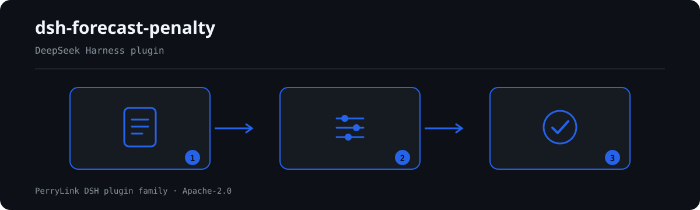

# dsh-forecast-penalty — Registo de avaliação da precisão da previsão e verificação aritmética do encargo de avaliação

[English](README.md) · [简体中文](README-zh.md) · [Español](README-es.md) · [Português](README-pt.md) · [हिन्दी](README-hi.md)

[](https://dsh.market/)
[](https://dshfind.com/en/plugins/PerryLink/dsh-forecast-penalty?ref=badge)

`dsh-forecast-penalty` lê um registo de avaliação da precisão da previsão —o cabeçalho mais uma linha por período de avaliação— e verifica a completude e a aritmética desse mesmo registo: se o período, o sujeito avaliado e o tipo de mercado estão identificados, se os valores de previsão, valor real e precisão são analisáveis como números, se a precisão registada concorda com a fórmula de definição que você configurar e o encargo de avaliação com a fórmula de cálculo que você configurar, se a moeda está escrita como código de três letras, se não há períodos de avaliação repetidos e se não resta nenhum marcador de modelo na coluna de observações. Toda a verificação que não possa ser executada é reportada em `skipped` com o respetivo motivo.

## Install

```sh
dsh plugin --profile <name> add dsh-forecast-penalty
dsh --profile <name> --dump-config | grep 'dsh-forecast-penalty'
```

## Como é a saída



*Visão geral do fluxo: chamada → plugin → resultado. Os exemplos abaixo usam a superfície real de comandos.*


Saída real deste plugin sobre o seu próprio fixture de teste `FP-002` — não é uma simulação. O pacote de regras não inventa citações, por isso cada achado nomeia a cláusula aplicada e avisa que o seu texto não foi obtido.

## O que ele responde

### Exemplos

A tabela abaixo é o conjunto de exemplos: a primeira linha é o caso detalhado e as demais são casos curtos.

#### Saída detalhada

**Ferramenta** `forecast_penalty`

**Entrada**

~~~json
{"rows":[{"考核期":"2026-03","预测值":"待补","实际值":"1000"}]}
~~~
 
**Saída**

~~~json
{
  "id": "dsh-forecast-penalty.FP-002.de09b5a6",
  "ruleId": "FP-002",
  "severity": "warn",
  "locator": {
    "field": "forecastValue",
    "row": 1
  },
  "found": "第 1 行「forecastValue」的值「待补」无法解析为数字",
  "expected": "「forecastValue」应填写数字",
  "fix": "预测值应填写数字；本条只核对可解析性，不判断预测是否准确"
}
~~~

*Observado em `tests/fixtures/FP-002/FP-002-unsafe.json (cases.json expects FP-002 count 1); run via lib/index.mjs rules/forecast-penalty.yaml`*

| Você pergunta | O que ele responde |
|---|---|
| O registo não diz que central nem que mercado abrange, e uma linha traz `--` como valor de previsão. | `FP-001` exige que o sujeito avaliado e o tipo de mercado estejam identificados, e `FP-002` que o valor de previsão seja analisável como número, pelo que um `--` é reportado. `FP-001` verifica que ambos estão preenchidos, não que o nome da central seja o correto, e `FP-002` não decide se a previsão foi acertada. |
| A precisão que registo não coincide com a fórmula de definição do meu mercado, e o encargo também não com base vezes tarifa unitária. | `FP-003` compara o valor registado com a fórmula de definição configurada no pacote de regras —a expressão de fábrica é uma convenção comum e um exemplo, não a regra do seu mercado: substitua `expression` ou desative a regra— com uma tolerância de 1,5 pontos. `FP-004` compara o encargo com `考核基数 × 考核单价` com uma tolerância de 0,01; a base é introduzida por você. Nenhuma das duas decide se o método de avaliação é aplicável nem se o encargo deve ser cobrado. |
| A coluna da moeda está vazia em algumas linhas e noutras diz `元`. | `FP-005` exige um código de três letras maiúsculas como CNY ou USD, pelo que tanto a célula vazia como o `元` são reportados; o limite da regra é que avalia apenas o formato e não decide que código a sua instituição deve usar para o renminbi. Também não decide se a moeda escolhida é a correta. |
| O mesmo período de avaliação aparece em mais do que uma linha. | `FP-006` reporta um período repetido, porque a duplicação faz o encargo acumular duas vezes e deixa sem saber se o período foi registado duas vezes ou avaliado duas vezes; a comparação ignora os espaços. Um mesmo período avaliado por faixas horárias e blocos produz legitimamente várias linhas: distinga-as na coluna de observações ou com outro identificador de período, ou desative a regra. Não decide qual das linhas é a duplicada. |
| A coluna de observações ainda contém `【】`, `XXX` ou `TBD`. | `FP-007` reporta a linha quando a coluna de observações contém um dos marcadores configurados no pacote de regras, porque um registo copiado de um modelo leva a supor que a avaliação foi mesmo feita. A lista `terms` é sua para ajustar, e a regra não decide se o texto da observação é verdadeiro. |
| Falta uma coluna inteira no meu material — a regra passa em silêncio? | Não. As regras por coluna (`FP-002`, `FP-005`, `FP-006`, `FP-007`) reportam-se a si mesmas em `skipped` com o motivo de que o material não traz essa coluna, e o relatório distingue esse caso do de uma regra que foi executada e não encontrou nenhuma linha com diferenças. Uma verificação que nunca foi executada não é apresentada como superada. |

## Normas que segue

| Documento | Número | Regras que o citam |
|---|---|---|
| 电力市场考核办法与并网调度协议（无国家标准） | 无统一标准（本条依据为台账可追溯性） | FP-001 |
| 电力市场考核办法与并网调度协议（无国家标准） | 无统一标准（本条依据为算术可行性） | FP-002 |
| 电力市场考核办法与并网调度协议（无国家标准） | 无统一标准（本条依据为本机构配置的准确率定义式） | FP-003 |
| 电力市场考核办法与并网调度协议（无国家标准） | 无统一标准（本条依据为本机构配置的考核算式） | FP-004 |
| 《表示货币的代码》 | GB/T 12406—2022（表示货币的代码；2022-12-30 发布并实施；全部代替 GB/T 12406—2008（该版名称为「表示货币和资金的代码」）——注意旧版名称含"资金"；修改采用 ISO 4217:2015，非等同采用；条号本次未取得） | FP-005 |
| 电力市场考核办法与并网调度协议（无国家标准） | 无统一标准（本条依据为台账唯一性） | FP-006 |
| 电力市场考核办法与并网调度协议（无国家标准） | 无统一标准（本条依据为台账真实性） | FP-007 |

**Boundary:** this plugin checks a **预测准确率考核台账** for arithmetic — that the period and subject are
identified, that forecast and actual figures parse, that the accuracy figure matches the definition formula
you configure, that the assessment charge matches your charge formula, that the currency follows its format,
that periods do not repeat, and that no placeholder survives. It does **not** decide whether a charge should be
levied, whether accuracy passes, or whether a waiver or appeal applies. **Those depend on the market rules, the
exemption cases and the dispute procedure.**

> ### ⚠️ This is a market rule, not a national standard — and the pack says so
>
> The accuracy definition, the exemption threshold, the unit rate and the settlement basis are set by **each
> power market's assessment rules and the grid-connection dispatch agreement**. Provinces differ sharply (some
> use `1 − deviation`, some use root-mean-square error, some assess by time block and band), and **no unified
> national standard exists**. So this pack does not fabricate a standard number: every rule's `excerpt` states
> plainly that its basis is arithmetic self-consistency or a locally configured convention and that **no
> citable clause exists**.
>
> **Two formulas ship as examples, and both are marked as such:**
>
> - `FP-003` **accuracy** defaults to `预测值 ÷ 实际值 × 100` with a 1.5-point tolerance. That is **one common
>   convention, not any market's rule**. Before use, replace `expression` with the formula from your market's
>   rules — or disable the rule. The note spells this out.
> - `FP-004` **charge** checks `考核费用 = 考核基数 × 考核单价`. The base is **entered by you** after working
>   it out under your market's rules, because the threshold, the bands and the volume basis are the market's
>   business and this plugin will not derive them. No unit rate is built in anywhere.
>
> A consequence worth knowing: the accuracy rule ships at `info` severity precisely because its formula is a
> deployment choice rather than a verified requirement.

## Compatibility

| Superfície | Estado |
|---|---|
| Harness | Faixa de peers `>=0.1.2-rc.1 <0.2.0 \|\| >=0.2.0-0 <0.3.0` — verificada para aceitar tanto `0.2.0-rc.2` quanto `0.2.1-rc.2`. **`engines.dsh` é declarado como `>=0.2.1-0 <0.3.0`** e o host o aplica desde 0.2.1 |
| Node | `^22.19.0 || >=24.0.0` |
| Plataformas | Todas (ESM puro; sem código nativo, sem rede, sem chamada ao modelo) |
| Modo de ferramenta | Funciona em `native` e `ptc`; para um diretório inteiro use `ptc` |

## What it does

A tabela de regras, os campos e o comportamento detalhado estão em [README.md](README.md#what-it-does) (versão principal em inglês). O plugin apenas lista divergências literais frente às cláusulas citadas e indica em `skipped` cada verificação que não pôde ser executada.

## Configuration

Todos os parâmetros ajustáveis ficam no esquema Schemastery de `src/config.ts`, portanto mudam pelo `cordis.yml` sem editar código; os limites por regra ficam no pacote de regras sob `rules/`.

| Chave | Tipo | Padrão | Descrição |
|---|---|---|---|
| `rulesFile` | string | `rules/forecast-penalty.yaml` | Caminho do pacote de regras, relativo à raiz do pacote |
| `disabledRules` | string[] | `[]` | Ids de regras a desativar; cada uma aparece em `skipped` |
| `onlyRules` | string[] | `[]` | Executar apenas estas regras; vazio executa todas |
| `skipNotes` | string | `""` | Nota acrescentada a cada motivo de `skipped` |
| `timeoutMs` | number | `120000` | Orçamento de tempo limite cooperativo da ferramenta |

## Material format

Aceita JSON ou YAML. O exemplo completo de campos está em [README.md](README.md#material-format) (versão principal em inglês). Os campos são opcionais na camada de leitura e validados pelo motor, de modo que uma exportação parcial gera achados sobre o que falta em vez de falhar.

## Rule sources

Os dados das regras ficam separados do código: cada regra traz documento, número, cláusula na numeração própria da fonte, trecho literal e URL de origem. O carregador impõe que o trecho seja citação real de pelo menos oito caracteres e que uma verificação baseada apenas em princípio geral (`kind: derived-from-principle`, teto `warn`) ou em política local (`kind: institutional-configuration`, teto `info`) nunca seja declarada `error`.

Os limites verificados e as conclusões deliberadamente **não** afirmadas estão em [README.md](README.md#rule-sources) (versão principal em inglês) e em `rules/evidence/`.

## Troubleshooting

- **O plugin instala mas a ferramenta não aparece**: confirme que `main` resolve para `lib/index.mjs` e que `pnpm run build` o gerou.
- **`dsh plugin add` recusa o pacote**: a faixa de peers cobre `0.1.x` e `0.2.x`; fora dela, conceda isenção explícita com `dsh plugin --profile <name> allow-version <pkg@ver> --dsh-version <runtime> --accept-risk`.
- **Uma regra não executou**: leia o arranjo `skipped`.
- **`check` informa `manifest-peers` como falha**: problema conhecido do `dsh-plugin-dev`; o runtime aplica a compatibilidade na instalação.
- **Os horários parecem deslocados**: toda a aritmética é de hora local sobre as cadeias fornecidas.

## Development

```sh
pnpm install
pnpm run typecheck
pnpm test
pnpm run build
node ../scripts/sync-shared.mjs dsh-forecast-penalty
```

O último comando copia o kit compartilhado de `../_shared` para `src/shared/`; execute-o novamente após cada alteração compartilhada.

## PerryLink DSH Plugin Family

Este projeto faz parte da família de plugins do DeepSeek Harness da [PerryLink](https://github.com/PerryLink). O registro fica recolhido abaixo para que cada README mantenha uma primeira tela curta; expanda para ver cada linha e seu status.

<details>
<summary>Expandir todos os plugins</summary>

| Plugin | Status |
|---|---|
| **[dsh-aqua-input-check](https://github.com/PerryLink/dsh-aqua-input-check)** |  |
| **[dsh-archive-check](https://github.com/PerryLink/dsh-archive-check)** |  |
| **[dsh-auto-review](https://github.com/PerryLink/dsh-auto-review)** |  |
| **[dsh-autotier](https://github.com/PerryLink/dsh-autotier)** |  |
| **[dsh-bid-ca-precheck](https://github.com/PerryLink/dsh-bid-ca-precheck)** |  |
| **[dsh-bid-qual-check](https://github.com/PerryLink/dsh-bid-qual-check)** |  |
| **[dsh-cert-mcp](https://github.com/PerryLink/dsh-cert-mcp)** |  |
| **[dsh-checkpoint-rewind](https://github.com/PerryLink/dsh-checkpoint-rewind)** |  |
| **[dsh-click](https://github.com/PerryLink/dsh-click)** |  |
| **[dsh-composer-history](https://github.com/PerryLink/dsh-composer-history)** |  |
| **[dsh-contract-stance](https://github.com/PerryLink/dsh-contract-stance)** |  |
| **[dsh-customs-doc-check](https://github.com/PerryLink/dsh-customs-doc-check)** |  |
| **[dsh-data-quality](https://github.com/PerryLink/dsh-data-quality)** |  |
| **[dsh-demurrage-ledger](https://github.com/PerryLink/dsh-demurrage-ledger)** |  |
| **[dsh-doublecheck](https://github.com/PerryLink/dsh-doublecheck)** |  |
| **[dsh-drill-script-check](https://github.com/PerryLink/dsh-drill-script-check)** |  |
| **[dsh-eia-guide-check](https://github.com/PerryLink/dsh-eia-guide-check)** |  |
| **[dsh-emergency-plan](https://github.com/PerryLink/dsh-emergency-plan)** |  |
| **[dsh-essay-rubric-check](https://github.com/PerryLink/dsh-essay-rubric-check)** |  |
| **[dsh-evidence-check](https://github.com/PerryLink/dsh-evidence-check)** |  |
| **[dsh-export-ctl-check](https://github.com/PerryLink/dsh-export-ctl-check)** |  |
| **[dsh-fast](https://github.com/PerryLink/dsh-fast)** |  |
| **[dsh-fmea-table-check](https://github.com/PerryLink/dsh-fmea-table-check)** |  |
| **[dsh-forecast-penalty](https://github.com/PerryLink/dsh-forecast-penalty)** |  |
| **[dsh-fund-research](https://github.com/PerryLink/dsh-fund-research)** |  |
| **[dsh-github](https://github.com/PerryLink/dsh-github)** |  |
| **[dsh-gongwen-flow-check](https://github.com/PerryLink/dsh-gongwen-flow-check)** |  |
| **[dsh-gongwen-word-check](https://github.com/PerryLink/dsh-gongwen-word-check)** |  |
| **[dsh-guard-plan-qc](https://github.com/PerryLink/dsh-guard-plan-qc)** |  |
| **[dsh-hazchem-check](https://github.com/PerryLink/dsh-hazchem-check)** |  |
| **[dsh-hazplan-check](https://github.com/PerryLink/dsh-hazplan-check)** |  |
| **[dsh-hidden-risk-map](https://github.com/PerryLink/dsh-hidden-risk-map)** |  |
| **[dsh-hs-classify](https://github.com/PerryLink/dsh-hs-classify)** |  |
| **[dsh-icd-rule-check](https://github.com/PerryLink/dsh-icd-rule-check)** |  |
| **[dsh-industry-research](https://github.com/PerryLink/dsh-industry-research)** |  |
| **[dsh-lawcite-adapter](https://github.com/PerryLink/dsh-lawcite-adapter)** |  |
| **[dsh-laya](https://github.com/PerryLink/dsh-laya)** |  |
| **[dsh-lc-doc-check](https://github.com/PerryLink/dsh-lc-doc-check)** |  |
| **[dsh-learning-gap-check](https://github.com/PerryLink/dsh-learning-gap-check)** |  |
| **[dsh-library](https://github.com/PerryLink/dsh-library)** |  |
| **[dsh-local-ai](https://github.com/PerryLink/dsh-local-ai)** |  |
| **[dsh-lsp-actions](https://github.com/PerryLink/dsh-lsp-actions)** |  |
| **[dsh-mask](https://github.com/PerryLink/dsh-mask)** |  |
| **[dsh-mcp-panel](https://github.com/PerryLink/dsh-mcp-panel)** |  |
| **[dsh-medrec-qc](https://github.com/PerryLink/dsh-medrec-qc)** |  |
| **[dsh-memento](https://github.com/PerryLink/dsh-memento)** |  |
| **[dsh-nsfc-form-check](https://github.com/PerryLink/dsh-nsfc-form-check)** |  |
| **[dsh-nurse-record-check](https://github.com/PerryLink/dsh-nurse-record-check)** |  |
| **[dsh-observe](https://github.com/PerryLink/dsh-observe)** |  |
| **[dsh-origin-rvc-check](https://github.com/PerryLink/dsh-origin-rvc-check)** |  |
| **[dsh-ota-review-check](https://github.com/PerryLink/dsh-ota-review-check)** |  |
| **[dsh-output-styles](https://github.com/PerryLink/dsh-output-styles)** |  |
| **[dsh-paper-doc-adapter](https://github.com/PerryLink/dsh-paper-doc-adapter)** |  |
| **[dsh-permission-rules](https://github.com/PerryLink/dsh-permission-rules)** |  |
| **[dsh-permit-report-check](https://github.com/PerryLink/dsh-permit-report-check)** |  |
| **[dsh-pipeline-check](https://github.com/PerryLink/dsh-pipeline-check)** |  |
| **[dsh-pleading-draft](https://github.com/PerryLink/dsh-pleading-draft)** |  |
| **[dsh-plugin-doctor](https://github.com/PerryLink/dsh-plugin-doctor)** |  |
| **[dsh-plugin-guide](https://github.com/PerryLink/dsh-plugin-guide)** |  |
| **[dsh-plugin-kit](https://github.com/PerryLink/dsh-plugin-kit)** |  |
| **[dsh-plugin-upgrade](https://github.com/PerryLink/dsh-plugin-upgrade)** |  |
| **[dsh-policy-brief-draft](https://github.com/PerryLink/dsh-policy-brief-draft)** |  |
| **[dsh-power-loss-split](https://github.com/PerryLink/dsh-power-loss-split)** |  |
| **[dsh-power-ticket-check](https://github.com/PerryLink/dsh-power-ticket-check)** |  |
| **[dsh-ppap-check](https://github.com/PerryLink/dsh-ppap-check)** |  |
| **[dsh-protest-deadline](https://github.com/PerryLink/dsh-protest-deadline)** |  |
| **[dsh-railway-window](https://github.com/PerryLink/dsh-railway-window)** |  |
| **[dsh-repair-order-qc](https://github.com/PerryLink/dsh-repair-order-qc)** |  |
| **[dsh-research-report](https://github.com/PerryLink/dsh-research-report)** |  |
| **[dsh-review-reply-check](https://github.com/PerryLink/dsh-review-reply-check)** |  |
| **[dsh-rulefile-check](https://github.com/PerryLink/dsh-rulefile-check)** |  |
| **[dsh-safety-brief-check](https://github.com/PerryLink/dsh-safety-brief-check)** |  |
| **[dsh-score](https://github.com/PerryLink/dsh-score)** |  |
| **[dsh-session-sync](https://github.com/PerryLink/dsh-session-sync)** |  |
| **[dsh-site-log-check](https://github.com/PerryLink/dsh-site-log-check)** |  |
| **[dsh-skill-pack-security](https://github.com/PerryLink/dsh-skill-pack-security)** |  |
| **[dsh-soe-decision-check](https://github.com/PerryLink/dsh-soe-decision-check)** |  |
| **[dsh-soilwater-check](https://github.com/PerryLink/dsh-soilwater-check)** |  |
| **[dsh-sop-sync-check](https://github.com/PerryLink/dsh-sop-sync-check)** |  |
| **[dsh-spc-gbt-adapter](https://github.com/PerryLink/dsh-spc-gbt-adapter)** |  |
| **[dsh-talk](https://github.com/PerryLink/dsh-talk)** |  |
| **[dsh-tender-extract](https://github.com/PerryLink/dsh-tender-extract)** |  |
| **[dsh-tender-matrix](https://github.com/PerryLink/dsh-tender-matrix)** |  |
| **[dsh-test-drive](https://github.com/PerryLink/dsh-test-drive)** |  |
| **[dsh-ticktick](https://github.com/PerryLink/dsh-ticktick)** |  |
| **[dsh-translate](https://github.com/PerryLink/dsh-translate)** |  |
| **[dsh-warranty-calc](https://github.com/PerryLink/dsh-warranty-calc)** |  |
| **[dsh-budget](https://github.com/PerryLink/dsh-budget)** | 🧊 CONGELADO — ver o README do repositório |
| **[dsh-claude-move](https://github.com/PerryLink/dsh-claude-move)** | 🧊 CONGELADO — ver o README do repositório |
| **[dsh-defend](https://github.com/PerryLink/dsh-defend)** | 🧊 CONGELADO — ver o README do repositório |
| **[dsh-draw](https://github.com/PerryLink/dsh-draw)** | 🧊 CONGELADO — ver o README do repositório |
| **[dsh-reach](https://github.com/PerryLink/dsh-reach)** | 🧊 CONGELADO — ver o README do repositório |
| **[dsh-background-agents](https://github.com/PerryLink/dsh-background-agents)** | 🚫 RETIRADO — ver o README do repositório |
| **[dsh-session-pin](https://github.com/PerryLink/dsh-session-pin)** | 🚫 RETIRADO — ver o README do repositório |
| **[dsh-team-rooms](https://github.com/PerryLink/dsh-team-rooms)** | 🚫 RETIRADO — ver o README do repositório |

</details>

## License

[Apache License 2.0](LICENSE) © 2026 dsh-forecast-penalty contributors.
