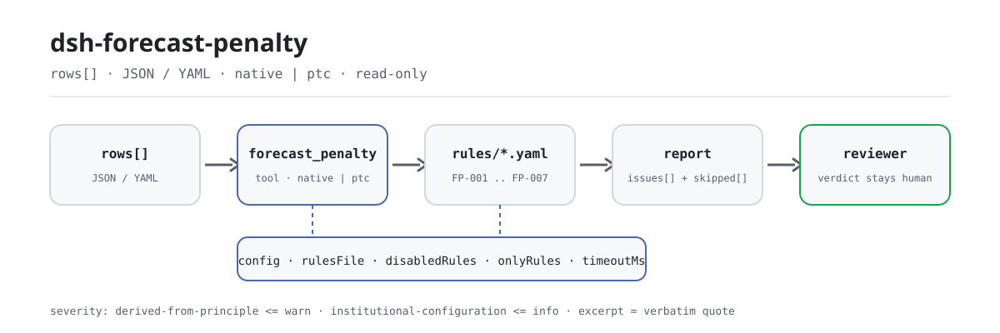

<div align="center">

<picture>
  <source media="(prefers-color-scheme: dark)" srcset="docs/assets/dsh-forecast-penalty-flow-dark.svg">
  
</picture>

# dsh-forecast-penalty

**पूर्वानुमान-सटीकता मूल्यांकन रजिस्टर की पूर्णता और मूल्यांकन-शुल्क की अंकगणितीय जाँच करें — आपको यह सूची मिलती है कि कौन-सी पंक्ति, कौन-सा कॉलम और क्या सुधारना है; अंतिम निर्णय समीक्षक के पास रहता है।**

DeepSeek Harness के लिए केवल-डेटा वाला जाँच प्लगइन: यह एक पूर्वानुमान-सटीकता मूल्यांकन रजिस्टर पढ़ता है (विषय हेडर और प्रत्येक मूल्यांकन अवधि की एक पंक्ति), साथ आने वाले संस्करण-बद्ध नियम-पैक (FP-001..FP-007) को लागू करता है, और केवल वही अंतर गिनाता है जिन्हें सामग्री के भीतर इंगित किया जा सकता है — कभी अनुपालन का निर्णय नहीं, कभी दायित्व का निर्णय नहीं।

[इंस्टॉल](#तीन-चरणों-में-शुरुआत) · [कॉन्फ़िगरेशन](#कॉन्फ़िगरेशन) · [FAQ](#faq) · [简体中文](README.md) · [English](README.en.md) · [Español](README.es.md) · [Português](README.pt.md) · [हिन्दी](README.hi.md)

[](LICENSE)
[](#संगतता)
[](https://www.npmjs.com/package/dsh-forecast-penalty)
[](https://github.com/PerryLink/dsh-forecast-penalty/actions/workflows/ci.yml)
[](#संगतता)

[](https://github.com/PerryLink/dsh-forecast-penalty/stargazers)
[](https://www.npmjs.com/package/dsh-forecast-penalty)
[](https://dshfind.com/plugins/PerryLink/dsh-forecast-penalty?ref=badge)
[](https://securityscorecards.dev/viewer/?uri=github.com/PerryLink/dsh-forecast-penalty)
[](https://dsh.market/)
[](https://gitee.com/perrylink/dsh-forecast-penalty)

```sh
dsh plugin --profile <name> add dsh-forecast-penalty
```

</div>

<sub>सामुदायिक प्लगइन, DeepSeek से संबद्ध नहीं। आधिकारिक रेपो: <https://github.com/PerryLink/dsh-forecast-penalty> (Gitee प्रतिबिंब है)।</sub>

## यह क्या है

`dsh-forecast-penalty` एक पूर्वानुमान-सटीकता मूल्यांकन रजिस्टर पढ़ता है — विषय हेडर और प्रत्येक मूल्यांकन अवधि की एक पंक्ति — और उसी रजिस्टर की पूर्णता तथा अंकगणित की जाँच करता है: क्या अवधि, मूल्यांकन का विषय और बाज़ार-प्रकार दर्ज हैं, क्या पूर्वानुमान, वास्तविक और सटीकता के अंक संख्याओं के रूप में पढ़े जा सकते हैं, क्या दर्ज सटीकता आपके द्वारा कॉन्फ़िगर किए गए परिभाषा-सूत्र से और मूल्यांकन शुल्क आपके द्वारा कॉन्फ़िगर किए गए गणना-सूत्र से मेल खाता है, क्या मुद्रा तीन अक्षरों के कोड के रूप में लिखी है, क्या कोई मूल्यांकन अवधि दोहराई नहीं गई है, और क्या टिप्पणी-कॉलम में कोई अपूरित प्लेसहोल्डर शेष नहीं है। जो जाँच चल नहीं सकती, वह `skipped` में अपना कारण बताती है।

यह यह नहीं तय करता कि मूल्यांकन विधि लागू होती है, सटीकता सीमा तक पहुँचती है, या शुल्क लिया जाना चाहिए अथवा माफ़ किया जा सकता है।

- **किसके लिए**: अनुबंध प्रबंधन और मूल्यांकन-निपटान टीम; कमांड लाइन जानने की ज़रूरत नहीं — सामग्री चैट में सौंप दें।
- **आप क्या देते हैं**: वह मूल सामग्री जिस पर जाँच काम करती है (तालिका, रजिस्टर या दस्तावेज़); मूल कभी नहीं बदला जाता। Excel को पहले JSON/YAML में बदला जा सकता है, प्लेटफ़ॉर्म समर्थन हो तो चैट में भी।
- **आपको क्या मिलता है**: «कौन-सी पंक्ति, कौन-सा कॉलम, क्या अनुपस्थित है और कैसे सुधारें» की सूची; जो जाँच नहीं चल पाई, वह `skipped` में कारण के साथ सूचीबद्ध होती है।

## तीन चरणों में शुरुआत

1. **इंस्टॉल करें** (एक चैनल चुनें):

   ```sh
   # git चैनल (नवीनतम main; git+https://github.com/PerryLink/dsh-forecast-penalty.git के बराबर)
   dsh plugin --profile <name> add github:PerryLink/dsh-forecast-penalty
   # npm चैनल (प्रकाशित संस्करण)
   dsh plugin --profile <name> add dsh-forecast-penalty
   # tarball चैनल: इस रेपो में pnpm pack के बाद
   dsh plugin --profile <name> add ./dsh-forecast-penalty-<version>.tgz
   ```

2. **न्यूनतम कॉन्फ़िगरेशन** (डिफ़ॉल्ट ही पर्याप्त हैं; `config` के बिना bundle पंक्ति सभी डिफ़ॉल्ट लेती है और नियम-पैक पथ साथ आए `rules/forecast-penalty.yaml` की ओर इशारा करता है):

   ```yaml
   - insert:
       - id: dsh-forecast-penalty
         name: dsh-forecast-penalty
   ```

3. **जाँचें कि यह माउंट होता है**:

   ```sh
   dsh --profile <name> --dump-config | grep 'dsh-forecast-penalty'
   ```

   फिर इसे एक रजिस्टर सौंपें — उदाहरण के लिए साथ आई नमूना सामग्री (अपेक्षित आउटपुट `samples/quickstart/expected/result.json` में):

   ```text
   > साथ आई नमूना सामग्री पर यह जाँच चलाएँ और बताएँ कि कितने मुद्दे मिले और उनकी गंभीरता क्या है।
   forecast_penalty: 1 issue(s) — warn 1 (FP-001); skipped: 0
   ```

**अनइंस्टॉल**: `dsh plugin --profile <name> remove dsh-forecast-penalty` (या प्रोफ़ाइल पैच से वह पंक्ति हटा दें)।

<details>
<summary>WorkBuddy / Coze में उपयोग करें</summary>

WorkBuddy / Coze में «Professional Document Check Suite» खोजें (पूरा सेट; यह जाँच उसका एक भाग है; उपलब्धता सूची के अनुसार) और बिना कमांड लाइन उसी जाँच क्षमता का उपयोग करें।

</details>

<details>
<summary>DSH Desktop मार्केट से इंस्टॉल करें</summary>

सभी PerryLink प्लगइन DSH Desktop के अंतर्निहित मार्केट में सूचीबद्ध हैं: **मार्केट → स्रोत → स्रोत जोड़ें → चिपकाएँ** `https://perrylink-dsh-catalog.perrylink.workers.dev/catalog-source.json` **→ चुनें**। इंस्टॉल के लिए मार्केट का npm पहचान सत्यापन और आपकी पुष्टि अब भी आवश्यक है।

</details>

## मुख्य क्षमताएँ

`dsh-forecast-penalty` `forecast_penalty` उपकरण पंजीकृत करता है: यह एक मूल्यांकन रजिस्टर पढ़ता है, संस्करण-बद्ध नियम-पैक लागू करता है और एक रिपोर्ट लौटाता है।

- **एक डेटा-पैक में सात नियम** — नियम-पैक डेटा है, कोड नहीं (`rules/forecast-penalty.yaml`); उसे बदलने से पूरा नियम-समुच्चय बदल जाता है, TypeScript की एक पंक्ति भी नहीं छूनी पड़ती।
- **सामग्री पर केवल-पठन** — JSON या YAML स्वीकार करता है और मूल कभी नहीं बदलता; शुद्ध ESM, कोई नेटवर्क अनुरोध नहीं, कोई मॉडल कॉल नहीं।
- **कोई गढ़ा हुआ उद्धरण नहीं** — प्रत्येक नियम में `document` / `number` / `clause` / `excerpt` / `kind` / `source` होते हैं; `excerpt` शब्दशः उद्धरण होना चाहिए, और जिन नियमों का मूल पाठ इस बार प्राप्त नहीं हुआ वे स्वयं `excerpt` में यह कहते हैं और `derived-from-principle` चिह्नित रहते हैं।
- **गंभीरता साक्ष्य के अनुसार** — `derived-from-principle` का उच्चतम स्तर `warn`, संस्थागत कॉन्फ़िगरेशन (`institutional-configuration`) का `info`, और एक टेस्ट इसे सुनिश्चित करता है।
- **खाली सूची का अर्थ «कुछ भी गलत नहीं» नहीं** — जो जाँच नहीं चल पाई वह `skipped` में कारण के साथ आती है; कॉलम-आधारित नियम अपना कॉलम न मिलने पर स्वयं को `skipped` में बताता है, चुपचाप पास नहीं होता।
- **कोई निर्णायक शब्दावली नहीं** — रिपोर्ट केवल अंतर गिनाती है, अनुपालन, दायित्व या सत्यता पर कभी निर्णय नहीं देती; शब्दावली-रक्षक (wording guard) इसे लागू करता है और हर रिपोर्ट के साथ अस्वीकरण रहता है।

| नियम | जाँच | गंभीरता | आधार प्रकार |
|---|---|---|---|
| `FP-001` | रजिस्टर विषय और बाज़ार दर्ज करता है | warn | ट्रेसबिलिटी |
| `FP-002` | पूर्वानुमान मूल्य संख्या के रूप में पढ़ा जाता है | warn | अंकगणितीय व्यवहार्यता |
| `FP-003` | सटीकता आपके परिभाषा-सूत्र से मेल खाती है | info | स्थानीय सूत्र |
| `FP-004` | शुल्क आपके गणना-सूत्र से मेल खाता है | info | स्थानीय सूत्र |
| `FP-005` | मुद्रा तीन अक्षरों का कोड है | warn | GB/T 12406 |
| `FP-006` | मूल्यांकन अवधियाँ अद्वितीय हैं | warn | रजिस्टर की अद्वितीयता |
| `FP-007` | टिप्पणी-कॉलम में अपूरित प्लेसहोल्डर नहीं है | warn | रजिस्टर की अखंडता |

### उदाहरण

ये प्लगइन के वास्तविक प्रवेश-बिंदु हैं; एक बार इंस्टॉल करें और किसी एक को कॉल करें।

**विस्तृत उदाहरण** — उपकरण `forecast_penalty`, इनपुट:

```json
{"rows":[{"考核期":"2026-03","预测值":"待补","实际值":"1000"}]}
```

आउटपुट:

```json
{
  "id": "dsh-forecast-penalty.FP-002.de09b5a6",
  "ruleId": "FP-002",
  "severity": "warn",
  "locator": {
    "field": "forecastValue",
    "row": 1
  },
  "found": "第 1 行「forecastValue」的值「待补」无法解析为数字",
  "expected": "「forecastValue」应填写数字",
  "fix": "预测值应填写数字；本条只核对可解析性，不判断预测是否准确"
}
```

*Observed from `tests/fixtures/FP-002/FP-002-unsafe.json (cases.json expects FP-002 count 1); run via lib/index.mjs rules/forecast-penalty.yaml`*

### आप क्या पूछते हैं

| आपका सवाल | इसका जवाब |
|---|---|
| रजिस्टर में नहीं लिखा है कि मूल्यांकन किस स्टेशन और किस बाज़ार का है, और एक पंक्ति में पूर्वानुमान मूल्य `--` है। | `FP-001` मूल्यांकन के विषय और बाज़ार-प्रकार के दर्ज होने की अपेक्षा करता है, और `FP-002` पूर्वानुमान मूल्य के संख्या के रूप में पढ़े जाने की, इसलिए `--` दर्ज होता है। `FP-001` यह देखता है कि दोनों भरे हैं, यह नहीं कि स्टेशन का नाम सही है; `FP-002` यह नहीं तय करता कि पूर्वानुमान सही था या नहीं। |
| मेरे रजिस्टर की सटीकता मेरे बाज़ार के परिभाषा-सूत्र से मेल नहीं खाती, और शुल्क भी आधार गुणा इकाई-दर से मेल नहीं खाता। | `FP-003` दर्ज अंक की तुलना नियम-संग्रह में कॉन्फ़िगर परिभाषा-सूत्र से करता है — फ़ैक्टरी सूत्र एक प्रचलित परिपाटी और उदाहरण है, आपके बाज़ार का नियम नहीं, इसलिए `expression` बदलें या यह नियम बंद करें — सहनशीलता 1.5 अंक। `FP-004` शुल्क की तुलना `penaltyBase × penaltyRate` से 0.01 की सहनशीलता पर करता है; आधार आप स्वयं भरते हैं। दोनों में से कोई यह नहीं तय करता कि मूल्यांकन विधि लागू होती है या शुल्क लिया जाना चाहिए। |
| मुद्रा कॉलम कुछ पंक्तियों में खाली है और कुछ में स्थानीय इकाई लिखी है। | `FP-005` तीन बड़े अक्षरों का कोड मांगता है, जैसे CNY या USD, इसलिए खाली कोष्ठक और स्थानीय इकाई दोनों दर्ज होते हैं; इस नियम की सीमा यह है कि यह केवल प्रारूप देखता है और यह तय नहीं करता कि रॅनमिन्बी के लिए आपकी संस्था कौन-सा कोड लिखे। यह भी नहीं तय करता कि चुनी गई मुद्रा सही है। |
| एक ही मूल्यांकन अवधि एक से अधिक पंक्तियों में आई है। | `FP-006` दोहराई गई अवधि दर्ज करता है, क्योंकि दोहराव से शुल्क दो बार जुड़ जाता है और यह स्पष्ट नहीं रहता कि अवधि दो बार दर्ज हुई या दो बार मूल्यांकित हुई; तुलना में रिक्त स्थान छोड़ दिए जाते हैं। एक ही अवधि का समय-खंड और श्रेणी के अनुसार मूल्यांकन वैध रूप से कई पंक्तियाँ बना सकता है — उन्हें टिप्पणी-कॉलम में या अलग अवधि-चिह्न से अलग दिखाएँ, या नियम बंद करें। यह तय नहीं करता कि कौन-सी पंक्ति दोहराई गई है। |
| टिप्पणी-कॉलम में अब भी खाली कोष्ठक, `XXX` या `TBD` जैसे टेम्पलेट प्लेसहोल्डर पड़े हैं। | `FP-007` उस पंक्ति को दर्ज करता है जिसके टिप्पणी-कॉलम में नियम-संग्रह में कॉन्फ़िगर प्लेसहोल्डर में से कोई मिलता है, क्योंकि टेम्पलेट से उतारा रजिस्टर पढ़ने वाले को यह मानने पर उकसाता है कि वास्तविक मूल्यांकन हो चुका है। `terms` सूची आप अपने टेम्पलेट के अनुसार बदल सकते हैं, और यह नियम यह नहीं तय करता कि टिप्पणी का पाठ सच है। |
| मेरी सामग्री में कोई पूरा कॉलम ही न हो — क्या नियम चुपचाप पास हो जाता है? | नहीं। कॉलम-आधारित नियम (`FP-002`, `FP-005`, `FP-006`, `FP-007`) `skipped` में स्वयं को दर्ज करते हैं और बताते हैं कि सामग्री में वह कॉलम नहीं है; रिपोर्ट इस स्थिति को उस नियम से अलग रखती है जो चला और जिसे कोई भिन्न पंक्ति नहीं मिली। जो जाँच कभी चली ही नहीं, उसे पूरी हुई जाँच के रूप में नहीं दिखाया जाता। |

## यह किन मानकों पर आधारित है

| दस्तावेज़ | संख्यांक | इन्हें उद्धृत करने वाले नियम |
|---|---|---|
| 电力市场考核办法与并网调度协议（无国家标准） | 无统一标准（本条依据为台账可追溯性） | FP-001 |
| 电力市场考核办法与并网调度协议（无国家标准） | 无统一标准（本条依据为算术可行性） | FP-002 |
| 电力市场考核办法与并网调度协议（无国家标准） | 无统一标准（本条依据为本机构配置的准确率定义式） | FP-003 |
| 电力市场考核办法与并网调度协议（无国家标准） | 无统一标准（本条依据为本机构配置的考核算式） | FP-004 |
| 《表示货币的代码》 | GB/T 12406—2022（表示货币的代码；2022-12-30 发布并实施；全部代替 GB/T 12406—2008（该版名称为「表示货币和资金的代码」）——注意旧版名称含"资金"；修改采用 ISO 4217:2015，非等同采用；条号本次未取得） | FP-005 |
| 电力市场考核办法与并网调度协议（无国家标准） | 无统一标准（本条依据为台账唯一性） | FP-006 |
| 电力市场考核办法与并网调度协议（无国家标准） | 无统一标准（本条依据为台账真实性） | FP-007 |

**सीमा:** यह प्लगइन एक **पूर्वानुमान-सटीकता मूल्यांकन रजिस्टर** की अंकगणित की जाँच करता है — क्या अवधि और विषय दर्ज हैं, क्या पूर्वानुमान और वास्तविक अंक पढ़े जाते हैं, क्या सटीकता आपके कॉन्फ़िगर किए गए परिभाषा-सूत्र से मेल खाती है, क्या मूल्यांकन शुल्क आपके गणना-सूत्र से मेल खाता है, क्या मुद्रा अपने प्रारूप का पालन करती है, क्या अवधियाँ नहीं दोहराई जातीं और क्या कोई प्लेसहोल्डर शेष नहीं है। यह यह **नहीं** तय करता कि शुल्क लिया जाना चाहिए, सटीकता सीमा पार करती है, या छूट/अपील लागू होती है। **ये बाज़ार के नियमों, छूट के मामलों और विवाद प्रक्रिया पर निर्भर हैं।**

> ### ⚠️ यह बाज़ार का नियम है, राष्ट्रीय मानक नहीं — और नियम-पैक यही कहता है
>
> सटीकता की परिभाषा, छूट की सीमा, इकाई-दर और निपटान का आधार **प्रत्येक विद्युत बाज़ार के मूल्यांकन नियमों और ग्रिड-कनेक्शन डिस्पैच समझौते** द्वारा तय होते हैं। प्रांतों में बड़ा अंतर है (कहीं `1 − deviation`, कहीं वर्ग-माध्य-मूल त्रुटि, कहीं समय-खंड और श्रेणी से मूल्यांकन), और **कोई एकीकृत राष्ट्रीय मानक नहीं है**। इसलिए यह पैक कोई मानक संख्या नहीं गढ़ता: प्रत्येक नियम का `excerpt` स्पष्ट कहता है कि उसका आधार अंकगणितीय स्वसंगति या स्थानीय रूप से कॉन्फ़िगर परिपाटी है और **कोई उद्धरण-योग्य धारा नहीं है**।
>
> **दो सूत्र उदाहरण के रूप में साथ आते हैं, और दोनों को वैसे ही चिह्नित किया गया है:**
>
> - `FP-003` **सटीकता** डिफ़ॉल्ट रूप से `forecast ÷ actual × 100` और 1.5 अंक की सहनशीलता लेता है। वह **एक प्रचलित परिपाटी है, किसी बाज़ार का नियम नहीं**। उपयोग से पहले `expression` को अपने बाज़ार के नियमों के सूत्र से बदलें — या नियम बंद करें। नोट यह स्पष्ट करता है।
> - `FP-004` **शुल्क** `charge = penaltyBase × penaltyRate` की जाँच करता है। आधार **आप भरते हैं** — अपने बाज़ार के नियमों से निकालकर, क्योंकि सीमा, श्रेणियाँ और मात्रा का आधार बाज़ार का विषय है और यह प्लगइन उन्हें नहीं निकालता। कहीं भी कोई इकाई-दर अंतर्निहित नहीं है।
>
> जानने योग्य परिणाम: सटीकता नियम `info` गंभीरता के साथ इसलिए आता है क्योंकि उसका सूत्र एक परिनियोजन-चयन है, सत्यापित आवश्यकता नहीं।

## कॉन्फ़िगरेशन

सभी समायोज्य पैरामीटर `src/config.ts` की Schemastery `Config` फ़ील्ड हैं (cordis.yml से बदले जा सकते हैं); प्रति-नियम सीमाएँ `rules/` के नियम-पैक में हैं। id-लक्षित ओवरराइड पूरी पंक्ति बदल देता है — जिन भी कुंजियों की ज़रूरत हो, सब दोहराएँ।

| कुंजी | प्रकार | डिफ़ॉल्ट | विवरण |
|---|---|---|---|
| `rulesFile` | string | `rules/forecast-penalty.yaml` | नियम-पैक का पथ, पैकेज रूट के सापेक्ष |
| `disabledRules` | string[] | `[]` | बंद करने वाले नियम id; प्रत्येक `skipped` में दिखता है |
| `onlyRules` | string[] | `[]` | केवल ये नियम चलाएँ; खाली होने पर सभी नियम चलते हैं |
| `skipNotes` | string | `""` | हर `skipped` कारण के आगे जोड़ी जाने वाली टिप्पणी |
| `timeoutMs` | number | `120000` | उपकरण का सहकारी समय-सीमा बजट |

जानने योग्य नियम-स्तरीय पैरामीटर:

- `FP-003` `expression` — सटीकता की परिभाषा। `op` में `divide`, `product`, `sum`, `subtract` (पहला फ़ील्ड घटा बाकी) और `percent` (पहला फ़ील्ड ÷ दूसरा × 100) समर्थित हैं, साथ में वैकल्पिक `scale` गुणक। `tolerance` डिफ़ॉल्ट 1.5 अंक है; अपनी पूर्णांकन परिपाटी के अनुसार समायोजित करें।
- `FP-004` `expression` / `tolerance` — शुल्क का सूत्र, डिफ़ॉल्ट `penaltyBase × penaltyRate` और 0.01 की सहनशीलता।
- `FP-005` `pattern` — मुद्रा का प्रारूप; डिफ़ॉल्ट तीन बड़े अक्षर।
- `FP-007` `terms` — खोजे जाने वाले प्लेसहोल्डर।

प्रोफ़ाइल पैच में ओवरराइड का उदाहरण:

```yaml
- insert:
    - id: dsh-forecast-penalty
      name: dsh-forecast-penalty
      config:
        disabledRules: [FP-005]
        timeoutMs: 180000
```

## सामग्री प्रारूप

उपकरण JSON या YAML स्वीकार करता है:

```yaml
subject: 某某风电场
market: 省内现货
rows:
  - { 考核期: 2026-03, 预测值: '966', 实际值: '1000', 准确率: '96.60',
      考核门槛: '95', 考核基数: '80', 考核单价: '50', 考核费用: '4000', 币制: CNY }
```

कॉलम नाम बड़े/छोटे अक्षरों का भेद किए बिना और रिक्त स्थान, अंडरस्कोर तथा हाइफ़न छोड़कर मिलाए जाते हैं; रजिस्टर के अपने कॉलम नाम सुरक्षित रहते हैं, इसलिए निष्कर्ष उसी कॉलम का नाम लेता है जिसे वास्तव में पढ़ा गया। संख्यात्मक कोष्ठकों में हज़ार-विभाजक और प्रतिशत चिह्न हो सकते हैं। फ़ील्ड पढ़ने की परत में वैकल्पिक हैं और जाँच इंजन उन्हें सत्यापित करता है, इसलिए आंशिक निर्यात पर क्रैश के बजाय "अनुपस्थित" श्रेणी के निष्कर्ष मिलते हैं।

## नियमों के स्रोत

नियम-डेटा `rules/forecast-penalty.yaml` में है, कोड से अलग: प्रत्येक नियम में दस्तावेज़, संख्या, स्रोत की अपनी क्रमांकन-प्रणाली के अनुसार धारा, शब्दशः उद्धरण और स्रोत URL होता है। चूँकि मूल्यांकन-व्यवस्था बाज़ार का नियम है, मानक नहीं, पैक की `basis` प्रविष्टियाँ यह स्पष्ट कहती हैं और ऐसी धारा उद्धृत नहीं करतीं जो मौजूद ही नहीं; एकमात्र बाहरी संदर्भ मुद्रा-कोड मानक है, जिसका उद्धरण स्वीकार करता है कि धारा का पाठ प्राप्त नहीं हुआ।

लोड-समय रक्षक अब भी प्रत्येक नियम के लिए दस्तावेज़, धारा, उद्धरण और स्रोत मांगता है, और स्थानीय रूप से कॉन्फ़िगर जाँच को `error` चिह्नित करने से रोकता है। `scripts/check-citations.mjs` और `rules/citations-baseline.json` उन उद्धरणों को दर्ज करते हैं जो इस बार भी अनुसंधेय हैं: नया अनुसंधेय उद्धरण गेट विफल करता है, और आधार-रेखा की वह प्रविष्टि भी जो अब संधेय हो गई हो — इसलिए आधार-रेखा केवल घट सकती है। अपने आधार को बढ़ा-चढ़ाकर बताने वाला पैक लोड पर विफल होता है, आत्मविश्वासी दिखने वाली रिपोर्ट नहीं बनाता।

## FAQ

<details>
<summary>क्या यह हमारी ओर से अनुपालन का निर्णय देता है?</summary>

नहीं। यह केवल वे अंतर गिनाता है जिन्हें सामग्री के भीतर इंगित किया जा सकता है (कौन-सी पंक्ति, कौन-सा कॉलम, क्या अनुपस्थित है और कैसे सुधारें) और न तथ्यों पर निर्णय देता है न अनुपालन पर — निष्कर्ष सदा समीक्षक के पास रहता है। शब्दावली-रक्षक रिपोर्ट की भाषा लागू करता है और हर रिपोर्ट के साथ अस्वीकरण रहता है। यह भी नहीं तय करता कि सटीकता सीमा पार करती है या शुल्क लिया जाना चाहिए अथवा माफ़ किया जा सकता है।

</details>

<details>
<summary>क्या सामग्री अपलोड होती है या कहीं और सहेजी जाती है?</summary>

नहीं। यह एक ऑफ़लाइन जाँचकर्ता है: केवल वही सामग्री पढ़ता है जो आप उपकरण को देते हैं, कोई नेटवर्क अनुरोध नहीं करता, किसी मॉडल को कॉल नहीं करता, और इसमें कोई टेलीमेट्री, एनालिटिक्स या पृष्ठभूमि रिपोर्टिंग नहीं है। यह उपकरण-परिणाम और DSH होस्ट के अपने सत्र/लॉग भंडारण के बाहर कोई डेटा नहीं लिखता; वह भंडारण और उसकी अवधि होस्ट नियंत्रित करता है, और यह पैकेज दूसरी प्रति नहीं जोड़ता।

</details>

<details>
<summary>खाली `issues` सूची को «कुछ भी गलत नहीं» माना जा सकता है?</summary>

नहीं। जो जाँच नहीं चल पाई वह `skipped` में कारण के साथ सूचीबद्ध होती है (सामग्री में कोई कॉलम अनुपस्थित, `disabledRules` से रुका नियम)। कॉलम-आधारित नियम (`FP-002`, `FP-005`, `FP-006`, `FP-007`) अपना कॉलम न मिलने पर स्वयं को `skipped` में बताते हैं, पास होने का दिखावा नहीं करते। किसी रिपोर्ट से कोई निष्कर्ष निकालने से पहले `issues` और `skipped` दोनों पढ़ें।

</details>

<details>
<summary>क्या साथ आए दोनों सूत्र हमारे बाज़ार के नियम के रूप में उपयोग हो सकते हैं?</summary>

जैसे हैं वैसे नहीं। `FP-003` का सटीकता-सूत्र और `FP-004` का शुल्क-सूत्र दोनों **उदाहरण** हैं: पहला एक प्रचलित परिपाटी है, और दूसरे में आप मूल्यांकन-आधार अपने बाज़ार के नियमों से निकालकर भरते हैं, कोई इकाई-दर अंतर्निहित नहीं। उपयोग से पहले `expression` को अपनी संस्था की परिपाटी से बदलें, या नियम बंद करें; `FP-003` `info` के साथ इसलिए आता है क्योंकि उसका सूत्र परिनियोजन-चयन है।

</details>

<details>
<summary>क्या यह एक पूरी तिमाही की अवधियाँ एक साथ संभाल लेगा?</summary>

उपकरण `native` और `ptc` दोनों मोड में चलता है; बैच कार्य (एक तिमाही की अवधियाँ या पूरी निर्देशिका) के लिए `ptc` चुनें, जहाँ स्कीमा लागत एक बार चुकाई जाती है। जाँचें स्थानीय कॉलम-मिलान और अंकगणित हैं — कोई नेटवर्क अनुरोध नहीं, कोई मॉडल कॉल नहीं; `timeoutMs` (डिफ़ॉल्ट 120 सेकंड) सहकारी समय-सीमा बजट है।

</details>

## समस्या निवारण

- **`FP-003` हर पंक्ति पर चलता है।** सटीकता कॉन्फ़िगर किए गए सूत्र से भिन्न सूत्र से निकाली गई है। `expression` को अपने बाज़ार के सूत्र से बदलें या नियम बंद करें — परिभाषा के अंतर को छिपाने के लिए सहनशीलता न बढ़ाएँ।
- **`FP-004` स्वयं को `skipped` बताता है।** रजिस्टर में मूल्यांकन-आधार का कॉलम नहीं है, या शुल्क नहीं है। आधार आपको निकालकर दर्ज करना है; प्लगइन उसे नहीं निकालता।
- **`FP-005` स्थानीय मुद्रा-शब्द पर चलता है।** डिफ़ॉल्ट प्रारूप तीन बड़े अक्षर मांगता है। अपने निपटान दस्तावेज़ों की परिपाटी के अनुसार इसे कसें या ढीला करें।
- **`FP-006` एक ही अवधि पर दो बार चलता है।** समय-खंड (पीक/फ़्लैट/वैली) मूल्यांकन में यह वैध हो सकता है। पंक्तियों को अवधि-कॉलम में अलग दिखाएँ या टिप्पणी में लिखें।
- **कोई नियम कभी नहीं चला।** `skipped` सरणी देखें; वह नियम id और कारण बताती है।
- **प्लगइन इंस्टॉल हो गया पर उपकरण दिखता नहीं।** जाँचें कि `main` `lib/index.mjs` पर जाता है और `pnpm run build` ने उसे बनाया है; गलत `main` लोडर को प्रविष्टि चुपचाप छोड़ने पर मजबूर करता है।
- **`dsh plugin add` असंगत बताकर मना करता है।** peer रेंज `0.1.x` और `0.2.x` दोनों को कवर करती है; यदि आपका रनटाइम उसके बाहर है तो स्पष्ट छूट दें: `dsh plugin --profile <name> allow-version dsh-forecast-penalty@0.1.0 --dsh-version <runtime> --accept-risk`
- **`check` में `manifest-peers` विफल दिखता है।** स्थिर जाँचकर्ता 0.2 पंक्ति से पुरानी हार्ड-कोडेड peer रेंज से तुलना करता है। रनटाइम इंस्टॉल के समय peer संगतता लागू करता है, इसलिए घोषित रेंज सही है; यह `dsh-plugin-dev` की ज्ञात अपस्ट्रीम समस्या है।
- **समय खिसका हुआ लगता है।** सारी गणना इनपुट स्ट्रिंग पर वॉल-क्लॉक है, कोई टाइमज़ोन रूपांतरण नहीं।

## संगतता

| सतह | स्थिति |
|---|---|
| Harness | peer रेंज `>=0.1.2-rc.1 <0.2.0 \|\| >=0.2.0-0 <0.3.0` — `0.2.0-rc.2` और `0.2.1-rc.2` दोनों को स्वीकार करने के लिए सत्यापित। `engines.dsh` `>=0.2.1-0 <0.3.0` के रूप में घोषित है और 0.2.1 से होस्ट इसे लागू करता है |
| Node | `^22.19.0 \|\| >=24.0.0` |
| प्लेटफ़ॉर्म | सभी (शुद्ध ESM; कोई नेटिव कोड नहीं, कोई नेटवर्क नहीं, कोई मॉडल कॉल नहीं) |
| टूल मोड | `native` और `ptc` में काम करता है; पूरी तिमाही के लिए `ptc` चुनें |

## इकोसिस्टम और गुणवत्ता

- [Gitee प्रतिबिंब](https://gitee.com/perrylink/dsh-forecast-penalty) (समकालिक प्रतिबिंब; GitHub आधिकारिक है)
- [dshfind प्लगइन पृष्ठ](https://dshfind.com/plugins/PerryLink/dsh-forecast-penalty) (इंस्टॉल और रैंकिंग)
- [OpenSSF Scorecard रिपोर्ट](https://securityscorecards.dev/viewer/?uri=github.com/PerryLink/dsh-forecast-penalty) ([.github/workflows/scorecard.yml](.github/workflows/scorecard.yml) से संचालित)
- [DSH Market](https://dsh.market/) (सूचीबद्ध)
- **1024 स्टोर चैनल**: एक बार `npm i -g dsh1024`, फिर `dsh1024 plugin --profile <name> add dsh-forecast-penalty` ([deepseek1024.com](https://deepseek1024.com) की इंस्टॉल रैंकिंग में गिना जाता है)
- [इकोसिस्टम ज्ञान-आधार](https://perrylink.github.io/dsh-plugin-guide/) — प्लगइन विकास मार्गदर्शिका · मापे गए चयन-आँकड़े · रखरखाव के मानदंड

## डेवलपमेंट

```sh
pnpm install                                        # node ^22.19 || >=24
pnpm run typecheck                                  # tsc --noEmit
pnpm test                                           # vitest: साझा टेबल-प्लगइन सूट + युग्मित फ़िक्स्चर
pnpm run build                                      # tsdown -> lib/index.mjs + lib/index.d.mts
pnpm run verify:self-contained                      # निर्भरताएँ registry से हल होती हैं
pnpm run check:lockfile                             # lockfile ड्रिफ़्ट जाँच
pnpm run check:readmes                              # पाँच भाषाओं के README की एकरूपता
pnpm run check:citations                            # नियम-पैक उद्धरण आधार-रेखा
node ../scripts/sync-shared.mjs dsh-forecast-penalty   # ../_shared से src/shared ताज़ा करें
pnpm pack                                           # प्रकाशित tarball
```

यह प्लगइन **केवल-डेटा** है: `src/model.ts` तालिका का आकार घोषित करता है, साझा किट पढ़ने वाला और जाँच इंजन देता है, और नियम-पैक हर जाँच घोषित करता है। स्थानीय नमूना चलाना (`lib/` बनाने के लिए पहले `pnpm run build` आवश्यक):

```sh
node samples/quickstart/run.mjs --json
# => {"tool":"forecast_penalty","issueCount":1,"summary":{"error":0,"warn":1,"info":0},"skippedCount":0}
```

नमूना इनपुट `samples/quickstart/input/` में है, अपेक्षित आउटपुट `samples/quickstart/expected/result.json` में, और स्क्रीनशॉट `docs/assets/quickstart.png` में। README की छवियाँ [`scripts/gen-readme-assets.py`](scripts/gen-readme-assets.py) (Python + Pillow) से प्रोग्रामेटिक रूप से बनती हैं और दोबारा चलाई जा सकती हैं; पुराना एक-संस्करण प्रवाह आरेख और डेमो छवियाँ बाहरी लिंक के लिए `docs/assets/` में बनी रहती हैं, जबकि README केवल नए लाइट/डार्क युग्म का संदर्भ देते हैं।

Topics: `deepseek-harness`, `dsh`, `dsh-plugin`, `cordis`, `forecast`, `penalty`

## परिवार और आभार

यह परियोजना [PerryLink](https://github.com/PerryLink) द्वारा अनुरक्षित DeepSeek Harness प्लगइन परिवार का हिस्सा है (सभी Apache-2.0)। पूरा परिवार सूचकांक: [सामग्री के अनुसार जाँचकर्ता चुनें](https://perrylink.github.io/zh/checkers/choose/) और [सभी प्लगइन](https://github.com/PerryLink)। अगर यह उपयोगी हो, तो **एक स्टार अगले व्यक्ति को इसे खोजने में मदद करता है** — इसके पीछे कोई सुविधा नहीं है।

- [@PerryLink](https://github.com/PerryLink) — निर्माता और अनुरक्षक: केवल-डेटा नियम-पैक (FP-001..FP-007), `forecast_penalty` उपकरण, बाज़ार-नियम आधार नोट्स और पाँच-भाषा दस्तावेज़।

<details>
<summary>सभी प्लगइन विस्तारित करें</summary>

| प्लगइन | स्थिति |
|---|---|
| **[dsh-aqua-input-check](https://github.com/PerryLink/dsh-aqua-input-check)** |  |
| **[dsh-archive-check](https://github.com/PerryLink/dsh-archive-check)** |  |
| **[dsh-auto-review](https://github.com/PerryLink/dsh-auto-review)** |  |
| **[dsh-autotier](https://github.com/PerryLink/dsh-autotier)** | 🧊 फ़्रोज़न — रेपो README देखें |
| **[dsh-bid-ca-precheck](https://github.com/PerryLink/dsh-bid-ca-precheck)** |  |
| **[dsh-bid-qual-check](https://github.com/PerryLink/dsh-bid-qual-check)** |  |
| **[dsh-cert-mcp](https://github.com/PerryLink/dsh-cert-mcp)** | 🧊 फ़्रोज़न — रेपो README देखें |
| **[dsh-checkpoint-rewind](https://github.com/PerryLink/dsh-checkpoint-rewind)** |  |
| **[dsh-click](https://github.com/PerryLink/dsh-click)** |  |
| **[dsh-composer-history](https://github.com/PerryLink/dsh-composer-history)** |  |
| **[dsh-contract-stance](https://github.com/PerryLink/dsh-contract-stance)** |  |
| **[dsh-customs-doc-check](https://github.com/PerryLink/dsh-customs-doc-check)** |  |
| **[dsh-data-quality](https://github.com/PerryLink/dsh-data-quality)** | 🧊 फ़्रोज़न — रेपो README देखें |
| **[dsh-demurrage-ledger](https://github.com/PerryLink/dsh-demurrage-ledger)** |  |
| **[dsh-doublecheck](https://github.com/PerryLink/dsh-doublecheck)** |  |
| **[dsh-drill-script-check](https://github.com/PerryLink/dsh-drill-script-check)** |  |
| **[dsh-eia-guide-check](https://github.com/PerryLink/dsh-eia-guide-check)** |  |
| **[dsh-emergency-plan](https://github.com/PerryLink/dsh-emergency-plan)** |  |
| **[dsh-essay-rubric-check](https://github.com/PerryLink/dsh-essay-rubric-check)** |  |
| **[dsh-evidence-check](https://github.com/PerryLink/dsh-evidence-check)** |  |
| **[dsh-export-ctl-check](https://github.com/PerryLink/dsh-export-ctl-check)** |  |
| **[dsh-fast](https://github.com/PerryLink/dsh-fast)** |  |
| **[dsh-fmea-table-check](https://github.com/PerryLink/dsh-fmea-table-check)** |  |
| **[dsh-forecast-penalty](https://github.com/PerryLink/dsh-forecast-penalty)** |  |
| **[dsh-fund-research](https://github.com/PerryLink/dsh-fund-research)** |  |
| **[dsh-github](https://github.com/PerryLink/dsh-github)** |  |
| **[dsh-gongwen-flow-check](https://github.com/PerryLink/dsh-gongwen-flow-check)** |  |
| **[dsh-gongwen-word-check](https://github.com/PerryLink/dsh-gongwen-word-check)** |  |
| **[dsh-guard-plan-qc](https://github.com/PerryLink/dsh-guard-plan-qc)** |  |
| **[dsh-hazchem-check](https://github.com/PerryLink/dsh-hazchem-check)** |  |
| **[dsh-hazplan-check](https://github.com/PerryLink/dsh-hazplan-check)** |  |
| **[dsh-hidden-risk-map](https://github.com/PerryLink/dsh-hidden-risk-map)** |  |
| **[dsh-hs-classify](https://github.com/PerryLink/dsh-hs-classify)** |  |
| **[dsh-icd-rule-check](https://github.com/PerryLink/dsh-icd-rule-check)** |  |
| **[dsh-industry-research](https://github.com/PerryLink/dsh-industry-research)** |  |
| **[dsh-lawcite-adapter](https://github.com/PerryLink/dsh-lawcite-adapter)** |  |
| **[dsh-laya](https://github.com/PerryLink/dsh-laya)** |  |
| **[dsh-lc-doc-check](https://github.com/PerryLink/dsh-lc-doc-check)** |  |
| **[dsh-learning-gap-check](https://github.com/PerryLink/dsh-learning-gap-check)** |  |
| **[dsh-library](https://github.com/PerryLink/dsh-library)** |  |
| **[dsh-local-ai](https://github.com/PerryLink/dsh-local-ai)** |  |
| **[dsh-lsp-actions](https://github.com/PerryLink/dsh-lsp-actions)** |  |
| **[dsh-mask](https://github.com/PerryLink/dsh-mask)** |  |
| **[dsh-mcp-panel](https://github.com/PerryLink/dsh-mcp-panel)** |  |
| **[dsh-medrec-qc](https://github.com/PerryLink/dsh-medrec-qc)** |  |
| **[dsh-memento](https://github.com/PerryLink/dsh-memento)** | 🧊 फ़्रोज़न — रेपो README देखें |
| **[dsh-nsfc-form-check](https://github.com/PerryLink/dsh-nsfc-form-check)** |  |
| **[dsh-nurse-record-check](https://github.com/PerryLink/dsh-nurse-record-check)** |  |
| **[dsh-observe](https://github.com/PerryLink/dsh-observe)** |  |
| **[dsh-origin-rvc-check](https://github.com/PerryLink/dsh-origin-rvc-check)** |  |
| **[dsh-ota-review-check](https://github.com/PerryLink/dsh-ota-review-check)** |  |
| **[dsh-output-styles](https://github.com/PerryLink/dsh-output-styles)** |  |
| **[dsh-paper-doc-adapter](https://github.com/PerryLink/dsh-paper-doc-adapter)** |  |
| **[dsh-permission-rules](https://github.com/PerryLink/dsh-permission-rules)** |  |
| **[dsh-permit-report-check](https://github.com/PerryLink/dsh-permit-report-check)** |  |
| **[dsh-pipeline-check](https://github.com/PerryLink/dsh-pipeline-check)** |  |
| **[dsh-pleading-draft](https://github.com/PerryLink/dsh-pleading-draft)** |  |
| **[dsh-plugin-doctor](https://github.com/PerryLink/dsh-plugin-doctor)** | 🚫 रिटायर्ड (रेपो संग्रहीत) |
| **[dsh-plugin-guide](https://github.com/PerryLink/dsh-plugin-guide)** |  |
| **[dsh-plugin-kit](https://github.com/PerryLink/dsh-plugin-kit)** | 🚫 रिटायर्ड (रेपो संग्रहीत) |
| **[dsh-plugin-upgrade](https://github.com/PerryLink/dsh-plugin-upgrade)** | 🚫 रिटायर्ड (रेपो संग्रहीत) |
| **[dsh-policy-brief-draft](https://github.com/PerryLink/dsh-policy-brief-draft)** |  |
| **[dsh-power-loss-split](https://github.com/PerryLink/dsh-power-loss-split)** |  |
| **[dsh-power-ticket-check](https://github.com/PerryLink/dsh-power-ticket-check)** |  |
| **[dsh-ppap-check](https://github.com/PerryLink/dsh-ppap-check)** |  |
| **[dsh-protest-deadline](https://github.com/PerryLink/dsh-protest-deadline)** |  |
| **[dsh-railway-window](https://github.com/PerryLink/dsh-railway-window)** |  |
| **[dsh-repair-order-qc](https://github.com/PerryLink/dsh-repair-order-qc)** |  |
| **[dsh-research-report](https://github.com/PerryLink/dsh-research-report)** |  |
| **[dsh-review-reply-check](https://github.com/PerryLink/dsh-review-reply-check)** |  |
| **[dsh-rulefile-check](https://github.com/PerryLink/dsh-rulefile-check)** |  |
| **[dsh-safety-brief-check](https://github.com/PerryLink/dsh-safety-brief-check)** |  |
| **[dsh-score](https://github.com/PerryLink/dsh-score)** | 🧊 फ़्रोज़न — रेपो README देखें |
| **[dsh-session-sync](https://github.com/PerryLink/dsh-session-sync)** |  |
| **[dsh-site-log-check](https://github.com/PerryLink/dsh-site-log-check)** |  |
| **[dsh-skill-pack-security](https://github.com/PerryLink/dsh-skill-pack-security)** |  |
| **[dsh-soe-decision-check](https://github.com/PerryLink/dsh-soe-decision-check)** |  |
| **[dsh-soilwater-check](https://github.com/PerryLink/dsh-soilwater-check)** |  |
| **[dsh-sop-sync-check](https://github.com/PerryLink/dsh-sop-sync-check)** |  |
| **[dsh-spc-gbt-adapter](https://github.com/PerryLink/dsh-spc-gbt-adapter)** |  |
| **[dsh-talk](https://github.com/PerryLink/dsh-talk)** |  |
| **[dsh-tender-extract](https://github.com/PerryLink/dsh-tender-extract)** |  |
| **[dsh-tender-matrix](https://github.com/PerryLink/dsh-tender-matrix)** |  |
| **[dsh-test-drive](https://github.com/PerryLink/dsh-test-drive)** |  |
| **[dsh-ticktick](https://github.com/PerryLink/dsh-ticktick)** | 🚫 रिटायर्ड (रेपो संग्रहीत) |
| **[dsh-translate](https://github.com/PerryLink/dsh-translate)** |  |
| **[dsh-warranty-calc](https://github.com/PerryLink/dsh-warranty-calc)** |  |
| **[dsh-budget](https://github.com/PerryLink/dsh-budget)** | 🧊 फ़्रोज़न — रेपो README देखें |
| **[dsh-claude-move](https://github.com/PerryLink/dsh-claude-move)** | 🧊 फ़्रोज़न — रेपो README देखें |
| **[dsh-defend](https://github.com/PerryLink/dsh-defend)** | 🧊 फ़्रोज़न — रेपो README देखें |
| **[dsh-draw](https://github.com/PerryLink/dsh-draw)** | 🧊 फ़्रोज़न — रेपो README देखें |
| **[dsh-reach](https://github.com/PerryLink/dsh-reach)** | 🧊 फ़्रोज़न — रेपो README देखें |
| **[dsh-background-agents](https://github.com/PerryLink/dsh-background-agents)** | 🚫 रिटायर्ड (रेपो संग्रहीत) |
| **[dsh-session-pin](https://github.com/PerryLink/dsh-session-pin)** | 🚫 रिटायर्ड (रेपो संग्रहीत) |
| **[dsh-team-rooms](https://github.com/PerryLink/dsh-team-rooms)** | 🚫 रिटायर्ड (रेपो संग्रहीत) |

</details>

## लाइसेंस

[LICENSE](LICENSE) (Apache License 2.0) © 2026 dsh-forecast-penalty contributors

<p align="center"><sub>Apache-2.0 · सामुदायिक प्लगइन, DeepSeek से संबद्ध नहीं।</sub></p>
