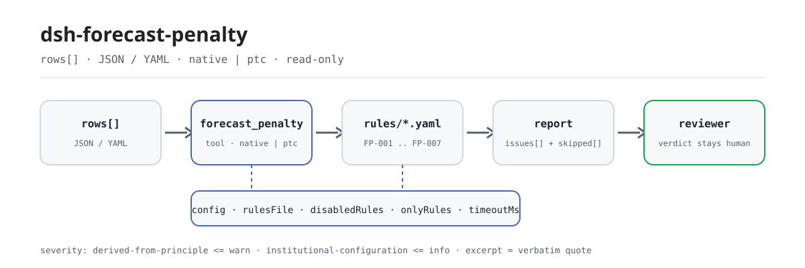

<div align="center">

<picture>
  <source media="(prefers-color-scheme: dark)" srcset="docs/assets/dsh-forecast-penalty-flow-dark.svg">
  
</picture>

# dsh-forecast-penalty

**核对预测准确率考核台账的齐备与考核费用算术——拿到一份「哪一行、哪一栏、差什么」的清单，定性结论留给审核人。**

面向 DeepSeek Harness 的数据型核查插件：读取一份预测准确率考核台账（表头加每个考核期一行），按随包的版本化规则包（FP-001..FP-007）逐条核对，只列材料内部能逐条指认的差异，不判合规、不认定责任。

[安装](#三步上手) · [配置](#配置) · [FAQ](#faq) · [简体中文](README.md) · [English](README.en.md) · [Español](README.es.md) · [Português](README.pt.md) · [हिन्दी](README.hi.md)

[](LICENSE)
[](#兼容性)
[](https://www.npmjs.com/package/dsh-forecast-penalty)
[](https://github.com/PerryLink/dsh-forecast-penalty/actions/workflows/ci.yml)
[](#兼容性)

[](https://github.com/PerryLink/dsh-forecast-penalty/stargazers)
[](https://www.npmjs.com/package/dsh-forecast-penalty)
[](https://dshfind.com/plugins/PerryLink/dsh-forecast-penalty?ref=badge)
[](https://securityscorecards.dev/viewer/?uri=github.com/PerryLink/dsh-forecast-penalty)
[](https://dsh.market/)
[](https://gitee.com/perrylink/dsh-forecast-penalty)

```sh
dsh plugin --profile <name> add dsh-forecast-penalty
```

</div>

<sub>社区插件，与 DeepSeek 官方无关。唯一仓库：<https://github.com/PerryLink/dsh-forecast-penalty>（Gitee 为镜像）。</sub>

## 它是什么

`dsh-forecast-penalty` 读取一份预测准确率考核台账——表头加每个考核期一行——核对这份台账自身的齐备与算术：考核期、考核对象与市场类型是否写明，预测值、实际值与准确率是否可解析为数值，台账所填准确率是否与贵机构配置的定义式相符、考核费用是否与配置的算式相符，币制是否写成三位字母代码，考核期是否重复，备注栏是否残留未替换的占位符。凡是无法执行的检查，都会在 `skipped` 中逐条说明原因。

它不判定考核办法是否适用、准确率是否达标，也不决定考核费用是否应当收取或能否减免。

- **给谁用**：合同管理、考核结算岗；不用懂命令行，在对话里把材料交给它即可。
- **你交什么**：这项核对用到的原始材料（表格、清单或文书）；不改原件。Excel 可先转成 JSON/YAML，对话里也能代转。
- **它交什么**：一份「哪一行、哪一栏、差什么、怎么补」的清单；没能执行的检查逐条列入 `skipped` 并写明原因。

## 三步上手

1. **安装**（三选一）：

   ```sh
   # git 通道（最新 main；等价于 git+https://github.com/PerryLink/dsh-forecast-penalty.git）
   dsh plugin --profile <name> add github:PerryLink/dsh-forecast-penalty
   # npm 通道（已发布版本）
   dsh plugin --profile <name> add dsh-forecast-penalty
   # tarball 通道：本仓库 pnpm pack 后
   dsh plugin --profile <name> add ./dsh-forecast-penalty-<version>.tgz
   ```

2. **最小配置**（默认即可用；bundle 行不带 `config` 时全部走默认值，规则包路径指向随包的 `rules/forecast-penalty.yaml`）：

   ```yaml
   - insert:
       - id: dsh-forecast-penalty
         name: dsh-forecast-penalty
   ```

3. **验证已生效**：

   ```sh
   dsh --profile <name> --dump-config | grep 'dsh-forecast-penalty'
   ```

   然后把一份台账交给它，例如用仓内自带样例（对应 `samples/quickstart/expected/result.json`）：

   ```text
   > 用自带样例跑一次这项检查，告诉我发现了几条问题、分别是什么级别。
   forecast_penalty: 1 issue(s) — warn 1（规则 FP-001）；skipped: 0
   ```

**卸载**：`dsh plugin --profile <name> remove dsh-forecast-penalty`（或从 profile patch 删掉该行）。

<details>
<summary>在 WorkBuddy / 扣子中使用</summary>

在 WorkBuddy / 扣子搜「投标合规核对包」（总包，本检查是其中一项；上架以商城为准）即可调用同一套核对能力，无需命令行。

</details>

<details>
<summary>从 DSH Desktop 市场安装</summary>

所有 PerryLink 插件均可在 DSH Desktop 内置市场中浏览：**市场 → 来源 → 添加来源 → 粘贴** `https://perrylink-dsh-catalog.perrylink.workers.dev/catalog-source.json` **→ 选中**。安装仍需通过市场的 npm 身份校验与你的确认。

</details>

## 核心能力

`dsh-forecast-penalty` 注册 `forecast_penalty` 工具：读入一份考核台账，套用版本化规则包，返回一份报告。

- **七条规则一包带走** —— 规则包是数据不是代码（`rules/forecast-penalty.yaml`），换掉规则包即换掉整套检查，不动一行 TypeScript。
- **只读材料** —— 接受 JSON 或 YAML，原件永不修改；纯 ESM，无网络请求、不调用模型。
- **引文不造假** —— 每条规则带 `document` / `number` / `clause` / `excerpt` / `kind` / `source`；`excerpt` 必须是逐字引文，本次未取得原文的规则在 `excerpt` 里如实写明并标为 `derived-from-principle`。
- **严重级跟着证据走** —— `derived-from-principle` 最高 `warn`，本机构配置（`institutional-configuration`）最高 `info`，并有测试断言。
- **空清单 ≠ 没问题** —— 每条没能执行的检查都进 `skipped` 并写明原因；按列核对的规则遇到材料缺列时自我报告 `skipped`，绝不静默通过。
- **措辞不作裁决** —— 报告只列差异，不判定合规、责任或正确性；措辞守卫（wording guard）强制执行，报告永远附带免责声明。

| 规则 | 核对内容 | 严重级 | 依据类别 |
|---|---|---|---|
| `FP-001` | 台账写明考核对象与市场类型 | warn | 台账可追溯性 |
| `FP-002` | 预测值可解析为数字 | warn | 算术可行性 |
| `FP-003` | 准确率符合贵机构配置的定义式 | info | 本地定义式 |
| `FP-004` | 考核费用符合贵机构配置的算式 | info | 本地算式 |
| `FP-005` | 币制为三位字母代码 | warn | GB/T 12406 |
| `FP-006` | 考核期在台账内唯一 | warn | 台账唯一性 |
| `FP-007` | 备注栏没有未替换的占位符 | warn | 台账真实性 |

### 示例

以下为插件真实入口；安装后调用一次即可。

**详细示例** — 工具 `forecast_penalty`，输入：

```json
{"rows":[{"考核期":"2026-03","预测值":"待补","实际值":"1000"}]}
```

输出：

```json
{
  "id": "dsh-forecast-penalty.FP-002.de09b5a6",
  "ruleId": "FP-002",
  "severity": "warn",
  "locator": {
    "field": "forecastValue",
    "row": 1
  },
  "found": "第 1 行「forecastValue」的值「待补」无法解析为数字",
  "expected": "「forecastValue」应填写数字",
  "fix": "预测值应填写数字；本条只核对可解析性，不判断预测是否准确"
}
```

*Observed from `tests/fixtures/FP-002/FP-002-unsafe.json (cases.json expects FP-002 count 1); run via lib/index.mjs rules/forecast-penalty.yaml`*

### 你会问什么

| 你会问 | 它怎么答 |
|---|---|
| 台账没有写考核对象是哪个场站、属于哪个市场，其中一行预测值写的是 `--`。 | `FP-001` 要求写明考核对象与市场类型，`FP-002` 要求预测值能解析为数值，`--` 会被报出。`FP-001` 只核对这两项是否填写，不判断场站名称是否正确；`FP-002` 不判断预测是否准确。 |
| 台账里的准确率与贵市场考核办法的定义式算出来的不一致，考核费用也与基数乘单价对不上。 | `FP-003` 拿台账所填数与规则库配置的定义式相比——出厂式只是一种常见写法、是示例而非贵市场的考核公式，请先把 `expression` 换成贵市场的定义式，或停用本条——容差 1.5 个百分点。`FP-004` 以 0.01 的容差核对 `考核基数 × 考核单价`，考核基数由使用方算出后填入。两条都不判断考核办法适用是否正确、是否应当收取考核费用。 |
| 币制这一栏有的行空着，有的行写的是「元」。 | `FP-005` 要求写成三位大写字母代码（如 CNY、USD），所以留空与写「元」都会被报出；本条的限制是只判断格式，不替贵机构规定人民币该写哪一种，也不判断币制选择是否正确。 |
| 同一个考核期在台账里出现了两行。 | `FP-006` 会报出重复的考核期，因为重复会让费用累计两次，也让人分不清是重复登记还是确有两次考核；比较时忽略空白字符。同一考核期分时段分档考核确实可能产生多行——请在备注栏说明或使用不同的考核期标识，也可以停用本条。它不判断哪一行是重复的。 |
| 备注栏还留着 `【】`、`XXX`、`TBD` 这样的字样。 | `FP-007` 在备注栏命中规则库配置的占位符时逐行报出，因为照抄模板的台账会让人误以为已经核对了实际考核。`terms` 清单可按贵机构模板调整，本条不判断备注内容是否真实。 |
| 材料里整列缺失时，规则会不会静默通过？ | 不会。按列核对的规则（`FP-002`、`FP-005`、`FP-006`、`FP-007`）会在 `skipped` 中自报，并说明材料没有该列；报告把这种情形与「已执行但未发现差异行」分开列出。没有执行过的检查，不会被当成已经过。 |

## 依据的标准

| 文件 | 文号 | 引用它的规则 |
|---|---|---|
| 电力市场考核办法与并网调度协议（无国家标准） | 无统一标准（本条依据为台账可追溯性） | FP-001 |
| 电力市场考核办法与并网调度协议（无国家标准） | 无统一标准（本条依据为算术可行性） | FP-002 |
| 电力市场考核办法与并网调度协议（无国家标准） | 无统一标准（本条依据为本机构配置的准确率定义式） | FP-003 |
| 电力市场考核办法与并网调度协议（无国家标准） | 无统一标准（本条依据为本机构配置的考核算式） | FP-004 |
| 《表示货币的代码》 | GB/T 12406—2022（表示货币的代码；2022-12-30 发布并实施；全部代替 GB/T 12406—2008（该版名称为「表示货币和资金的代码」）——注意旧版名称含"资金"；修改采用 ISO 4217:2015，非等同采用；条号本次未取得） | FP-005 |
| 电力市场考核办法与并网调度协议（无国家标准） | 无统一标准（本条依据为台账唯一性） | FP-006 |
| 电力市场考核办法与并网调度协议（无国家标准） | 无统一标准（本条依据为台账真实性） | FP-007 |

**边界：** 本插件核对一份 **预测准确率考核台账** 的算术——是否写明考核期与考核对象，预测值与实际值是否可解析为数值，准确率数值是否与你配置的定义公式相符，考核费用是否与你配置的考核费用公式相符，币制是否符合其形式，考核期是否不重复，以及是否残留占位符。它**不**判定是否应当收取考核费用、准确率是否合格，也不判定是否适用豁免或申诉。**这些取决于市场规则、豁免情形与争议处理程序。**

> ### ⚠️ 这是市场规则，不是国家标准——规则库也这样写明
>
> 准确率定义、豁免门槛、考核单价与结算依据，均由**各电力市场的考核规则与并网调度协议**设定。各省差异很大（有的用 `1 − deviation`，有的用均方根误差，有的分时段、分档考核），且**不存在统一的国家标准**。因此本规则库不编造一个标准数字：每条规则的 `excerpt` 都直说其依据是算术自洽或本地配置的约定，并说明**不存在可供引用的条款**。
>
> **有两个公式作为示例出厂，且两者都如此标明：**
>
> - `FP-003` **准确率**默认采用 `预测值 ÷ 实际值 × 100`，容差为 1.5 个百分点。那只是**一种常见约定，不是任何市场的规则**。使用前，请把 `expression` 替换为你所在市场规则中的公式——或停用该规则。其说明明确写出了这一点。
> - `FP-004` **考核费用**规则核对 `考核费用 = 考核基数 × 考核单价`。考核基数**由你填写**，其数值需按你所在市场的规则算好，因为门槛、档位与电量依据属于市场规则的范围，本插件不会代为推导。任何地方都没有内置考核单价。
>
> 有一个值得知道的后果：准确率规则之所以以 `info` 严重级别出厂，正是因为它的公式属于部署选择，而不是经过核实的要求。

## 配置

全部可调参数都在 `src/config.ts` 的 Schemastery schema 中，只改 `cordis.yml` 即可生效，无需改代码；逐条阈值在 `rules/` 下的规则库文件里。按 id 覆盖会替换整行——请重述所有需要的键。

| 键 | 类型 | 默认值 | 说明 |
|---|---|---|---|
| `rulesFile` | string | `rules/forecast-penalty.yaml` | 规则库文件路径，相对插件包根目录 |
| `disabledRules` | string[] | `[]` | 要停用的规则 id 列表；每条都会出现在 `skipped` 中 |
| `onlyRules` | string[] | `[]` | 只执行这些规则 id；留空表示执行全部规则 |
| `skipNotes` | string | `""` | 附加到每条 `skipped` 说明后的备注 |
| `timeoutMs` | number | `120000` | 工具协作式超时预算（毫秒） |

值得了解的规则级参数：

- `FP-003` `expression` —— 准确率定义式。`op` 支持 `divide`、`product`、`sum`、`subtract`（首字段减其余）与 `percent`（首字段 ÷ 第二字段 × 100），可带可选的 `scale` 乘数。`tolerance` 默认 1.5 个百分点，按贵机构取整口径调整。
- `FP-004` `expression` / `tolerance` —— 考核费用算式，默认 `考核基数 × 考核单价`，容差 0.01。
- `FP-005` `pattern` —— 币制形态，默认三位大写字母。
- `FP-007` `terms` —— 要查找的占位符清单。

profile patch 覆盖示例：

```yaml
- insert:
    - id: dsh-forecast-penalty
      name: dsh-forecast-penalty
      config:
        disabledRules: [FP-005]
        timeoutMs: 180000
```

## 材料格式

工具接受 JSON 或 YAML：

```yaml
subject: 某某风电场
market: 省内现货
rows:
  - { 考核期: 2026-03, 预测值: '966', 实际值: '1000', 准确率: '96.60',
      考核门槛: '95', 考核基数: '80', 考核单价: '50', 考核费用: '4000', 币制: CNY }
```

列名匹配忽略大小写，并忽略空格、下划线与连字符；台账自己的列名会被保留，因此发现里写明的列就是它实际读到的列。数值单元格可以带千分位分隔符与百分号。字段在读取层是可选的，由检查引擎校验，因此部分导出的材料会产生「缺项」类差异，而不是让程序崩溃。

## 规则来源

规则数据在 `rules/forecast-penalty.yaml`，与代码分离：每条规则都带文件名、文号、按原文自身编号体系的条款号、逐字摘录与来源地址。因为考核办法是市场规则而非标准，规则包的 `basis` 条目如实写明这一点，而不是引用一个并不存在的条款；唯一的外部引用是货币代码标准，其摘录承认本次未取得条文原文。

加载期守卫仍然要求每条规则具备 `document`、`clause`、`excerpt` 与 `source`，并且禁止把本地配置的检查标为 `error`。`scripts/check-citations.mjs` 配合 `rules/citations-baseline.json` 记录本次仍无法追溯的引文：新增一条无法追溯的摘录会让门禁失败，基线里已经变得可追溯的条目同样会让它失败，因此基线只会缩小。夸大依据的规则库会在加载期失败，而不会产出一份看起来很有底气的报告。

## FAQ

<details>
<summary>它会替我们下「合规 / 不合规」的结论吗？</summary>

不会。它只列出材料内部能逐条指认的差异（哪一行、哪一栏、差什么、怎么补），不下事实判断，也不评价合规性——结论永远留给审核人。报告措辞由 wording guard 强制约束，且每份报告都带免责声明。它同样不判断准确率是否达标、考核费用是否应当收取或能否减免。

</details>

<details>
<summary>材料会被上传或额外留存吗？</summary>

不会。它是一个离线核查器：只读取你交给工具的材料，不发起网络请求，不调用模型，也不带遥测或后台上报。它不在工具结果与 DSH 宿主自己的会话/日志存储之外另写一份数据；那部分存储及其保留策略由宿主控制，本包不会复制第二份。

</details>

<details>
<summary>`issues` 为空能当作「没问题」吗？</summary>

不能。每条没能执行的检查都列在 `skipped` 里并写明原因（例如材料缺列、规则被 `disabledRules` 停用）。按列核对的规则（`FP-002`、`FP-005`、`FP-006`、`FP-007`）在缺列时会自报 `skipped`，而不假装通过。判读报告时请把 `issues` 与 `skipped` 一起看完。

</details>

<details>
<summary>两个随包公式可以直接套我们的市场规则吗？</summary>

不要直接套。`FP-003` 的准确率定义式与 `FP-004` 的考核算式都是**示例**：前者是一种常见约定，后者把考核基数交给你按本市场办法算好后填入，且不内置任何单价。使用前把 `expression` 换成贵机构的口径，或停用对应规则；`FP-003` 以 `info` 出厂，正是因为它的公式属于部署选择。

</details>

<details>
<summary>一整个季度的台账一起查，性能吃得消吗？</summary>

工具在 `native` 与 `ptc` 两种模式都能跑；批量校验（例如整季台账或整个目录）建议 `ptc`，schema 成本只付一次。检查本身是纯本地的列匹配与算术比较，无网络请求、不调用模型；`timeoutMs`（默认 120 秒）是协作式超时预算。

</details>

## 排障

- **`FP-003` 对每一行都报。** 准确率是按与配置不同的公式算出来的。把 `expression` 换成贵市场的定义式，或停用本条——不要靠放宽容差来掩盖定义不一致。
- **`FP-004` 报告自身为 `skipped`。** 台账没有 `考核基数` 栏，或没有考核费用。考核基数由使用方算出后填入，本插件不会代为推导。
- **`FP-005` 对「元」报错。** 默认形态要求三位大写字母。按贵机构结算单据的口径收窄或放宽 `pattern`。
- **`FP-006` 对同一个考核期报两次。** 分时段（峰/平/谷）考核可能确实产生多行；在考核期栏区分这些行，或在备注栏写明。
- **某条规则没有执行。** 查看 `skipped` 数组，其中写明了规则 id 与原因。
- **插件装上了但工具不出现。** 确认 `main` 解析到 `lib/index.mjs`，且 `pnpm run build` 已产出该文件；`main` 写错会让加载器静默跳过该条目。
- **`dsh plugin add` 以不兼容为由拒绝安装。** peer 范围覆盖 `0.1.x` 与 `0.2.x`；若运行时在其之外，可显式豁免：`dsh plugin --profile <name> allow-version dsh-forecast-penalty@0.1.0 --dsh-version <runtime> --accept-risk`
- **`check` 把 `manifest-peers` 报为失败。** 静态检查器比对的是一份早于 0.2 世代的硬编码 peer 范围；安装期的 peer 校验以运行时为准，声明的范围才是正确的。这是 `dsh-plugin-dev` 的已知上游问题。
- **时间看起来偏移。** 全部计算都是对输入字符串做墙上时钟运算，不做时区换算。

## 兼容性

| 项目 | 状态 |
|---|---|
| Harness | 对等版本范围 `>=0.1.2-rc.1 <0.2.0 \|\| >=0.2.0-0 <0.3.0` —— 已实测同时接受 `0.2.0-rc.2` 与 `0.2.1-rc.2`。已声明 `engines.dsh`：0.2.1 起由宿主单独裁决，范围为 `>=0.2.1-0 <0.3.0` |
| Node | `^22.19.0 \|\| >=24.0.0` |
| 平台 | 全平台（纯 ESM；无原生代码、无联网、不调用模型） |
| 工具模式 | `native` / `ptc` 均可；批量校验整个季度时建议 `ptc`，schema 成本只付一次 |

## 生态与质量

- [Gitee 镜像](https://gitee.com/perrylink/dsh-forecast-penalty)（同步镜像，以 GitHub 为准）
- [dshfind 插件页](https://dshfind.com/plugins/PerryLink/dsh-forecast-penalty)（安装量与排名）
- [OpenSSF Scorecard 报告](https://securityscorecards.dev/viewer/?uri=github.com/PerryLink/dsh-forecast-penalty)（由 [.github/workflows/scorecard.yml](.github/workflows/scorecard.yml) 驱动）
- [DSH Market](https://dsh.market/)（已上架）
- **1024 商店渠道**：先 `npm i -g dsh1024`，再 `dsh1024 plugin --profile <name> add dsh-forecast-penalty`（计入 [deepseek1024.com](https://deepseek1024.com) 安装排行）
- [生态实测知识库](https://perrylink.github.io/dsh-plugin-guide/)：插件开发指南 · 选型实测数据 · 维护取舍判据

## 开发

```sh
pnpm install                                        # node ^22.19 || >=24
pnpm run typecheck                                  # tsc --noEmit
pnpm test                                           # vitest：共享表格插件套件 + 成对夹具
pnpm run build                                      # tsdown -> lib/index.mjs + lib/index.d.mts
pnpm run verify:self-contained                      # 依赖 spec 均来自 registry
pnpm run check:lockfile                             # lockfile 漂移检查
pnpm run check:readmes                              # 五语 README 一致性
pnpm run check:citations                            # 规则包引文基线
node ../scripts/sync-shared.mjs dsh-forecast-penalty   # 从 ../_shared 刷新 src/shared
pnpm pack                                           # 发布 tarball
```

本插件是**数据型**的：`src/model.ts` 声明表格结构，共享套件提供读取器与检查引擎，规则包声明每一条检查。本地样例试跑（需先 `pnpm run build` 产出 `lib/`）：

```sh
node samples/quickstart/run.mjs --json
# => {"tool":"forecast_penalty","issueCount":1,"summary":{"error":0,"warn":1,"info":0},"skippedCount":0}
```

样例输入在 `samples/quickstart/input/`，期望输出在 `samples/quickstart/expected/result.json`，截图见 `docs/assets/quickstart.png`。README 配图由 [`scripts/gen-readme-assets.py`](scripts/gen-readme-assets.py) 程序化生成（Python + Pillow），可重复执行；旧的单版流程图与演示图保留在 `docs/assets/` 供外链使用，README 只引用新生成的深浅双版。

Topics：`deepseek-harness`, `dsh`, `dsh-plugin`, `cordis`, `forecast`, `penalty`

## 家族与致谢

本项目是 [PerryLink](https://github.com/PerryLink) 维护的 DeepSeek Harness 插件家族成员（全部 Apache-2.0）。完整家族索引见[按材料选核查器](https://perrylink.github.io/zh/checkers/choose/)。如果这个插件帮到了你，**给个 star**——它不解锁任何功能，但会让下一个人更容易找到它。

- [@PerryLink](https://github.com/PerryLink) —— 创建者与维护者：数据型规则包（FP-001..FP-007）、`forecast_penalty` 工具、市场规则依据说明与五语文档。

<details>
<summary>展开全部插件</summary>

| 插件 | 状态 |
|---|---|
| **[dsh-aqua-input-check](https://github.com/PerryLink/dsh-aqua-input-check)** |  |
| **[dsh-archive-check](https://github.com/PerryLink/dsh-archive-check)** |  |
| **[dsh-auto-review](https://github.com/PerryLink/dsh-auto-review)** |  |
| **[dsh-autotier](https://github.com/PerryLink/dsh-autotier)** | 🧊 已冻结 — 见仓库 README |
| **[dsh-bid-ca-precheck](https://github.com/PerryLink/dsh-bid-ca-precheck)** |  |
| **[dsh-bid-qual-check](https://github.com/PerryLink/dsh-bid-qual-check)** |  |
| **[dsh-cert-mcp](https://github.com/PerryLink/dsh-cert-mcp)** | 🧊 已冻结 — 见仓库 README |
| **[dsh-checkpoint-rewind](https://github.com/PerryLink/dsh-checkpoint-rewind)** |  |
| **[dsh-click](https://github.com/PerryLink/dsh-click)** |  |
| **[dsh-composer-history](https://github.com/PerryLink/dsh-composer-history)** |  |
| **[dsh-contract-stance](https://github.com/PerryLink/dsh-contract-stance)** |  |
| **[dsh-customs-doc-check](https://github.com/PerryLink/dsh-customs-doc-check)** |  |
| **[dsh-data-quality](https://github.com/PerryLink/dsh-data-quality)** | 🧊 已冻结 — 见仓库 README |
| **[dsh-demurrage-ledger](https://github.com/PerryLink/dsh-demurrage-ledger)** |  |
| **[dsh-doublecheck](https://github.com/PerryLink/dsh-doublecheck)** |  |
| **[dsh-drill-script-check](https://github.com/PerryLink/dsh-drill-script-check)** |  |
| **[dsh-eia-guide-check](https://github.com/PerryLink/dsh-eia-guide-check)** |  |
| **[dsh-emergency-plan](https://github.com/PerryLink/dsh-emergency-plan)** |  |
| **[dsh-essay-rubric-check](https://github.com/PerryLink/dsh-essay-rubric-check)** |  |
| **[dsh-evidence-check](https://github.com/PerryLink/dsh-evidence-check)** |  |
| **[dsh-export-ctl-check](https://github.com/PerryLink/dsh-export-ctl-check)** |  |
| **[dsh-fast](https://github.com/PerryLink/dsh-fast)** |  |
| **[dsh-fmea-table-check](https://github.com/PerryLink/dsh-fmea-table-check)** |  |
| **[dsh-forecast-penalty](https://github.com/PerryLink/dsh-forecast-penalty)** |  |
| **[dsh-fund-research](https://github.com/PerryLink/dsh-fund-research)** |  |
| **[dsh-github](https://github.com/PerryLink/dsh-github)** |  |
| **[dsh-gongwen-flow-check](https://github.com/PerryLink/dsh-gongwen-flow-check)** |  |
| **[dsh-gongwen-word-check](https://github.com/PerryLink/dsh-gongwen-word-check)** |  |
| **[dsh-guard-plan-qc](https://github.com/PerryLink/dsh-guard-plan-qc)** |  |
| **[dsh-hazchem-check](https://github.com/PerryLink/dsh-hazchem-check)** |  |
| **[dsh-hazplan-check](https://github.com/PerryLink/dsh-hazplan-check)** |  |
| **[dsh-hidden-risk-map](https://github.com/PerryLink/dsh-hidden-risk-map)** |  |
| **[dsh-hs-classify](https://github.com/PerryLink/dsh-hs-classify)** |  |
| **[dsh-icd-rule-check](https://github.com/PerryLink/dsh-icd-rule-check)** |  |
| **[dsh-industry-research](https://github.com/PerryLink/dsh-industry-research)** |  |
| **[dsh-lawcite-adapter](https://github.com/PerryLink/dsh-lawcite-adapter)** |  |
| **[dsh-laya](https://github.com/PerryLink/dsh-laya)** |  |
| **[dsh-lc-doc-check](https://github.com/PerryLink/dsh-lc-doc-check)** |  |
| **[dsh-learning-gap-check](https://github.com/PerryLink/dsh-learning-gap-check)** |  |
| **[dsh-library](https://github.com/PerryLink/dsh-library)** |  |
| **[dsh-local-ai](https://github.com/PerryLink/dsh-local-ai)** |  |
| **[dsh-lsp-actions](https://github.com/PerryLink/dsh-lsp-actions)** |  |
| **[dsh-mask](https://github.com/PerryLink/dsh-mask)** |  |
| **[dsh-mcp-panel](https://github.com/PerryLink/dsh-mcp-panel)** |  |
| **[dsh-medrec-qc](https://github.com/PerryLink/dsh-medrec-qc)** |  |
| **[dsh-memento](https://github.com/PerryLink/dsh-memento)** | 🧊 已冻结 — 见仓库 README |
| **[dsh-nsfc-form-check](https://github.com/PerryLink/dsh-nsfc-form-check)** |  |
| **[dsh-nurse-record-check](https://github.com/PerryLink/dsh-nurse-record-check)** |  |
| **[dsh-observe](https://github.com/PerryLink/dsh-observe)** |  |
| **[dsh-origin-rvc-check](https://github.com/PerryLink/dsh-origin-rvc-check)** |  |
| **[dsh-ota-review-check](https://github.com/PerryLink/dsh-ota-review-check)** |  |
| **[dsh-output-styles](https://github.com/PerryLink/dsh-output-styles)** |  |
| **[dsh-paper-doc-adapter](https://github.com/PerryLink/dsh-paper-doc-adapter)** |  |
| **[dsh-permission-rules](https://github.com/PerryLink/dsh-permission-rules)** |  |
| **[dsh-permit-report-check](https://github.com/PerryLink/dsh-permit-report-check)** |  |
| **[dsh-pipeline-check](https://github.com/PerryLink/dsh-pipeline-check)** |  |
| **[dsh-pleading-draft](https://github.com/PerryLink/dsh-pleading-draft)** |  |
| **[dsh-plugin-doctor](https://github.com/PerryLink/dsh-plugin-doctor)** | 🚫 已退役（仓库已归档） |
| **[dsh-plugin-guide](https://github.com/PerryLink/dsh-plugin-guide)** |  |
| **[dsh-plugin-kit](https://github.com/PerryLink/dsh-plugin-kit)** | 🚫 已退役（仓库已归档） |
| **[dsh-plugin-upgrade](https://github.com/PerryLink/dsh-plugin-upgrade)** | 🚫 已退役（仓库已归档） |
| **[dsh-policy-brief-draft](https://github.com/PerryLink/dsh-policy-brief-draft)** |  |
| **[dsh-power-loss-split](https://github.com/PerryLink/dsh-power-loss-split)** |  |
| **[dsh-power-ticket-check](https://github.com/PerryLink/dsh-power-ticket-check)** |  |
| **[dsh-ppap-check](https://github.com/PerryLink/dsh-ppap-check)** |  |
| **[dsh-protest-deadline](https://github.com/PerryLink/dsh-protest-deadline)** |  |
| **[dsh-railway-window](https://github.com/PerryLink/dsh-railway-window)** |  |
| **[dsh-repair-order-qc](https://github.com/PerryLink/dsh-repair-order-qc)** |  |
| **[dsh-research-report](https://github.com/PerryLink/dsh-research-report)** |  |
| **[dsh-review-reply-check](https://github.com/PerryLink/dsh-review-reply-check)** |  |
| **[dsh-rulefile-check](https://github.com/PerryLink/dsh-rulefile-check)** |  |
| **[dsh-safety-brief-check](https://github.com/PerryLink/dsh-safety-brief-check)** |  |
| **[dsh-score](https://github.com/PerryLink/dsh-score)** | 🧊 已冻结 — 见仓库 README |
| **[dsh-session-sync](https://github.com/PerryLink/dsh-session-sync)** |  |
| **[dsh-site-log-check](https://github.com/PerryLink/dsh-site-log-check)** |  |
| **[dsh-skill-pack-security](https://github.com/PerryLink/dsh-skill-pack-security)** |  |
| **[dsh-soe-decision-check](https://github.com/PerryLink/dsh-soe-decision-check)** |  |
| **[dsh-soilwater-check](https://github.com/PerryLink/dsh-soilwater-check)** |  |
| **[dsh-sop-sync-check](https://github.com/PerryLink/dsh-sop-sync-check)** |  |
| **[dsh-spc-gbt-adapter](https://github.com/PerryLink/dsh-spc-gbt-adapter)** |  |
| **[dsh-talk](https://github.com/PerryLink/dsh-talk)** |  |
| **[dsh-tender-extract](https://github.com/PerryLink/dsh-tender-extract)** |  |
| **[dsh-tender-matrix](https://github.com/PerryLink/dsh-tender-matrix)** |  |
| **[dsh-test-drive](https://github.com/PerryLink/dsh-test-drive)** |  |
| **[dsh-ticktick](https://github.com/PerryLink/dsh-ticktick)** | 🚫 已退役（仓库已归档） |
| **[dsh-translate](https://github.com/PerryLink/dsh-translate)** |  |
| **[dsh-warranty-calc](https://github.com/PerryLink/dsh-warranty-calc)** |  |
| **[dsh-budget](https://github.com/PerryLink/dsh-budget)** | 🧊 已冻结 — 见仓库 README |
| **[dsh-claude-move](https://github.com/PerryLink/dsh-claude-move)** | 🧊 已冻结 — 见仓库 README |
| **[dsh-defend](https://github.com/PerryLink/dsh-defend)** | 🧊 已冻结 — 见仓库 README |
| **[dsh-draw](https://github.com/PerryLink/dsh-draw)** | 🧊 已冻结 — 见仓库 README |
| **[dsh-reach](https://github.com/PerryLink/dsh-reach)** | 🧊 已冻结 — 见仓库 README |
| **[dsh-background-agents](https://github.com/PerryLink/dsh-background-agents)** | 🚫 已退役（仓库已归档） |
| **[dsh-session-pin](https://github.com/PerryLink/dsh-session-pin)** | 🚫 已退役（仓库已归档） |
| **[dsh-team-rooms](https://github.com/PerryLink/dsh-team-rooms)** | 🚫 已退役（仓库已归档） |

</details>

## License

[LICENSE](LICENSE)（Apache License 2.0）© 2026 dsh-forecast-penalty contributors

<p align="center"><sub>Apache-2.0 · 社区插件，与 DeepSeek 无关。</sub></p>
