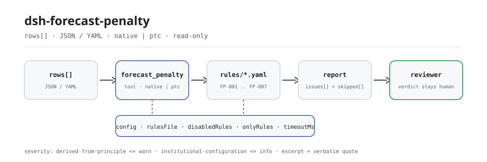

<div align="center">

<picture>
  <source media="(prefers-color-scheme: dark)" srcset="docs/assets/dsh-forecast-penalty-flow-dark.svg">
  
</picture>

# dsh-forecast-penalty

**Verifique a completude de um registro de avaliação da precisão da previsão e a aritmética do encargo de avaliação — você recebe uma lista de qual linha, qual coluna e o que corrigir; a conclusão fica com o revisor.**

Plugin verificador somente de dados para o DeepSeek Harness: lê um registro de avaliação da precisão da previsão (cabeçalho do sujeito mais uma linha por período de avaliação), aplica o pacote de regras versionado que acompanha (FP-001..FP-007) e lista apenas as diferenças que consegue apontar dentro do material — nunca um veredito de conformidade, nunca uma atribuição de responsabilidade.

[Instalar](#instalação-em-três-passos) · [Configuração](#configuração) · [FAQ](#faq) · [简体中文](README.md) · [English](README.en.md) · [Español](README.es.md) · [Português](README.pt.md) · [हिन्दी](README.hi.md)

[](LICENSE)
[](#compatibilidade)
[](https://www.npmjs.com/package/dsh-forecast-penalty)
[](https://github.com/PerryLink/dsh-forecast-penalty/actions/workflows/ci.yml)
[](#compatibilidade)

[](https://github.com/PerryLink/dsh-forecast-penalty/stargazers)
[](https://www.npmjs.com/package/dsh-forecast-penalty)
[](https://dshfind.com/plugins/PerryLink/dsh-forecast-penalty?ref=badge)
[](https://securityscorecards.dev/viewer/?uri=github.com/PerryLink/dsh-forecast-penalty)
[](https://dsh.market/)
[](https://gitee.com/perrylink/dsh-forecast-penalty)

```sh
dsh plugin --profile <name> add dsh-forecast-penalty
```

</div>

<sub>Plugin da comunidade, não afiliado ao DeepSeek. Repositório canônico: <https://github.com/PerryLink/dsh-forecast-penalty> (o Gitee é um espelho).</sub>

## O que é

`dsh-forecast-penalty` lê um registro de avaliação da precisão da previsão — o cabeçalho do sujeito mais uma linha por período de avaliação — e verifica a completude e a aritmética desse mesmo registro: se o período, o sujeito e o mercado estão identificados, se os valores de previsão, real y precisão podem ser lidos como números, se a precisão registrada concorda com a fórmula de definição que você configurar e o encargo de avaliação com a fórmula de cálculo que você configurar, se a moeda está escrita como código de três letras, se nenhum período de avaliação se repete e se nenhum marcador de modelo sobrou na coluna de observações. Toda verificação que não puder ser executada é informada em `skipped` com o motivo.

Não decide se o método de avaliação se aplica, se a precisão atinge o limite nem se o encargo deve ser cobrado ou dispensado.

- **Para quem é**: equipes de contratos e de liquidação de avaliações; não é preciso saber usar a linha de comando — entregue o material no chat.
- **O que você entrega**: o material de origem sobre o qual a verificação trabalha (uma tabela, um registro ou um documento); o original nunca é modificado. O Excel pode ser convertido antes para JSON/YAML, no chat se a plataforma permitir.
- **O que você recebe**: uma lista de «qual linha, qual coluna, o que falta e como corrigir»; toda verificação que não pôde ser executada é listada em `skipped` com o motivo.

## Instalação em três passos

1. **Instalar** (escolha um canal):

   ```sh
   # canal git (main mais recente; equivale a git+https://github.com/PerryLink/dsh-forecast-penalty.git)
   dsh plugin --profile <name> add github:PerryLink/dsh-forecast-penalty
   # canal npm (versões publicadas)
   dsh plugin --profile <name> add dsh-forecast-penalty
   # canal tarball: após pnpm pack neste repositório
   dsh plugin --profile <name> add ./dsh-forecast-penalty-<version>.tgz
   ```

2. **Configuração mínima** (os padrões bastam; uma linha de bundle sem `config` usa todos os padrões e o caminho do pacote de regras aponta para o `rules/forecast-penalty.yaml` incluído):

   ```yaml
   - insert:
       - id: dsh-forecast-penalty
         name: dsh-forecast-penalty
   ```

3. **Verificar se monta**:

   ```sh
   dsh --profile <name> --dump-config | grep 'dsh-forecast-penalty'
   ```

   Depois entregue um registro — por exemplo, a amostra incluída (saída esperada em `samples/quickstart/expected/result.json`):

   ```text
   > Rode esta verificação na amostra incluída e diga quantos problemas encontrou e com que gravidade.
   forecast_penalty: 1 issue(s) — warn 1 (FP-001); skipped: 0
   ```

**Desinstalar**: `dsh plugin --profile <name> remove dsh-forecast-penalty` (ou remova a linha do patch do perfil).

<details>
<summary>Usar no WorkBuddy / Coze</summary>

Pesquise «Professional Document Check Suite» no WorkBuddy / Coze (o conjunto completo; esta verificação é uma de suas partes; disponibilidade conforme o catálogo) para usar a mesma capacidade de verificação sem linha de comando.

</details>

<details>
<summary>Instalar pelo mercado do DSH Desktop</summary>

Todos os plugins da PerryLink estão no mercado integrado do DSH Desktop: **Mercado → Fontes → Adicionar fonte → colar** `https://perrylink-dsh-catalog.perrylink.workers.dev/catalog-source.json` **→ selecionar**. A instalação continua exigindo a verificação de identidade npm do mercado e a sua confirmação.

</details>

## Capacidades principais

`dsh-forecast-penalty` registra a ferramenta `forecast_penalty`: lê um registro de avaliação, aplica um pacote de regras versionado e devolve um relatório.

- **Sete regras em um pacote de dados** — o pacote de regras é dado, não código (`rules/forecast-penalty.yaml`); substituí-lo troca todo o conjunto de regras sem tocar numa linha de TypeScript.
- **Somente leitura sobre o material** — aceita JSON ou YAML e nunca modifica o original; ESM puro, sem requisições de rede e sem chamadas ao modelo.
- **Sem citações inventadas** — cada regra traz `document` / `number` / `clause` / `excerpt` / `kind` / `source`; `excerpt` precisa ser citação literal, e as regras cujo texto não foi obtido nesta passagem dizem isso no próprio `excerpt` e ficam marcadas como `derived-from-principle`.
- **A gravidade segue a evidência** — `derived-from-principle` tem teto `warn`, a configuração institucional (`institutional-configuration`) tem teto `info`, e um teste garante isso.
- **Uma lista vazia nunca é «nada está errado»** — toda verificação que não pôde ser executada é informada em `skipped` com o motivo; uma regra por coluna que não encontra a coluna declara-se em `skipped` em vez de passar em silêncio.
- **Sem linguagem que julgue** — o relatório lista diferenças e nunca se pronuncia sobre conformidade, responsabilidade ou correção; um guardião de redação (wording guard) impõe isso e todo relatório traz o aviso legal.

| Regra | Verificação | Gravidade | Tipo de base |
|---|---|---|---|
| `FP-001` | o registro identifica sujeito e mercado | warn | rastreabilidade |
| `FP-002` | o valor de previsão é lido como número | warn | viabilidade aritmética |
| `FP-003` | a precisão corresponde à sua fórmula de definição | info | fórmula local |
| `FP-004` | o encargo corresponde à sua fórmula de cálculo | info | fórmula local |
| `FP-005` | a moeda é um código de três letras | warn | GB/T 12406 |
| `FP-006` | os períodos de avaliação são únicos | warn | unicidade do registro |
| `FP-007` | a coluna de observações não guarda marcadores não substituídos | warn | integridade do registro |

### Exemplos

Estes são os pontos de entrada reais do plugin; instale uma vez e chame um.

**Exemplo detalhado** — ferramenta `forecast_penalty`, entrada:

```json
{"rows":[{"考核期":"2026-03","预测值":"待补","实际值":"1000"}]}
```

Saída:

```json
{
  "id": "dsh-forecast-penalty.FP-002.de09b5a6",
  "ruleId": "FP-002",
  "severity": "warn",
  "locator": {
    "field": "forecastValue",
    "row": 1
  },
  "found": "第 1 行「forecastValue」的值「待补」无法解析为数字",
  "expected": "「forecastValue」应填写数字",
  "fix": "预测值应填写数字；本条只核对可解析性，不判断预测是否准确"
}
```

*Observed from `tests/fixtures/FP-002/FP-002-unsafe.json (cases.json expects FP-002 count 1); run via lib/index.mjs rules/forecast-penalty.yaml`*

### O que você pergunta

| Você pergunta | O que ele responde |
|---|---|
| O registro não diz qual usina nem qual mercado cobre, e uma linha traz `--` como valor de previsão. | `FP-001` exige que o sujeito avaliado e o tipo de mercado estejam identificados, e `FP-002` que o valor de previsão possa ser lido como número, de modo que um `--` é informado. `FP-001` verifica se os dois estão preenchidos, não se o nome da usina é o correto, e `FP-002` não decide se a previsão estava certa. |
| A precisão que registro não bate com a fórmula de definição do meu mercado, e o encargo também não com base vezes tarifa unitária. | `FP-003` compara o valor registrado com a fórmula de definição configurada no pacote de regras — a expressão de fábrica é uma convenção comum e um exemplo, não a regra do seu mercado: substitua `expression` ou desative a regra — com tolerância de 1,5 ponto. `FP-004` compara o encargo com `penaltyBase × penaltyRate` com tolerância de 0,01; a base é informada por você. Nenhuma das duas decide se o método de avaliação se aplica nem se o encargo deve ser cobrado. |
| A coluna de moeda está vazia em algumas linhas e em outras traz a unidade local. | `FP-005` exige um código de três letras maiúsculas como CNY ou USD, então tanto a célula vazia quanto a palavra da unidade local são informadas; o limite da regra é que ela julga apenas o formato e não decide qual código a sua instituição deve usar para o renminbi. Também não decide se a moeda escolhida é a correta. |
| O mesmo período de avaliação aparece em mais de uma linha. | `FP-006` informa um período repetido, porque a duplicata faz o encargo acumular duas vezes e deixa sem saber se o período foi registrado duas vezes ou avaliado duas vezes; a comparação ignora espaços. Um mesmo período avaliado por faixa horária e bloco gera legitimamente várias linhas — distinga-as na coluna de observações ou com outro identificador de período, ou desative a regra. Não decide qual das linhas é a duplicada. |
| A coluna de observações ainda traz marcadores de modelo como colchetes vazios, `XXX` ou `TBD`. | `FP-007` informa a linha quando a coluna de observações contém um dos marcadores configurados no pacote de regras, porque um registro copiado de um modelo convida a supor que a avaliação foi realmente feita. A lista `terms` é sua para ajustar, e a regra não decide se o texto da observação é verdadeiro. |
| Falta uma coluna inteira no meu material — a regra passa em silêncio? | Não. As regras por coluna (`FP-002`, `FP-005`, `FP-006`, `FP-007`) informam-se em `skipped` com o motivo de que o material não traz essa coluna, e o relatório distingue esse caso do de uma regra que rodou e não achou nenhuma linha divergente. Uma verificação que nunca rodou nunca é apresentada como aprovada. |

## Normas que segue

| Documento | Número | Regras que o citam |
|---|---|---|
| 电力市场考核办法与并网调度协议（无国家标准） | 无统一标准（本条依据为台账可追溯性） | FP-001 |
| 电力市场考核办法与并网调度协议（无国家标准） | 无统一标准（本条依据为算术可行性） | FP-002 |
| 电力市场考核办法与并网调度协议（无国家标准） | 无统一标准（本条依据为本机构配置的准确率定义式） | FP-003 |
| 电力市场考核办法与并网调度协议（无国家标准） | 无统一标准（本条依据为本机构配置的考核算式） | FP-004 |
| 《表示货币的代码》 | GB/T 12406—2022（表示货币的代码；2022-12-30 发布并实施；全部代替 GB/T 12406—2008（该版名称为「表示货币和资金的代码」）——注意旧版名称含"资金"；修改采用 ISO 4217:2015，非等同采用；条号本次未取得） | FP-005 |
| 电力市场考核办法与并网调度协议（无国家标准） | 无统一标准（本条依据为台账唯一性） | FP-006 |
| 电力市场考核办法与并网调度协议（无国家标准） | 无统一标准（本条依据为台账真实性） | FP-007 |

**Limite:** este plugin verifica a aritmética de um **registro de avaliação da precisão da previsão** — se o período e o sujeito estão identificados, se os valores de previsão e real são lidos, se a precisão corresponde à fórmula de definição que você configurar, se o encargo de avaliação corresponde à sua fórmula de cálculo, se a moeda segue o formato, se os períodos não se repetem e se nenhum marcador permanece. **Não** decide se um encargo deve ser cobrado, se a precisão atinge o limite ou se cabe isenção ou recurso. **Isso depende das regras do mercado, dos casos de isenção e do procedimento de disputa.**

> ### ⚠️ Isto é uma regra de mercado, não uma norma nacional — e o pacote diz isso
>
> A definição de precisão, o limite de isenção, a tarifa unitária e a base de liquidação são definidos **pelas regras de avaliação de cada mercado elétrico e pelo acordo de despacho e conexão à rede**. As províncias diferem muito (umas usam `1 − deviation`, outras o erro quadrático médio, outras avaliam por faixa e bloco), e **não existe uma norma nacional unificada**. Por isso este pacote não inventa um número padrão: o `excerpt` de cada regra diz claramente que sua base é a coerência aritmética ou uma convenção configurada localmente e que **não existe cláusula citável**.
>
> **Duas fórmulas vêm como exemplos, e ambas estão marcadas como tal:**
>
> - `FP-003` **precisão** usa por padrão `forecast ÷ actual × 100` com tolerância de 1,5 ponto. Essa é **uma convenção comum, não a regra de nenhum mercado**. Antes de usar, substitua `expression` pela fórmula das regras do seu mercado — ou desative a regra. A nota explica isso.
> - `FP-004` **encargo** verifica `charge = penaltyBase × penaltyRate`. A base **é informada por você** depois de calculá-la pelas regras do seu mercado, porque o limite, as faixas e a base de volume são assunto do mercado e este plugin não os deriva. Não há nenhuma tarifa unitária embutida.
>
> Um detalhe que vale saber: a regra de precisão é distribuída com gravidade `info` justamente porque sua fórmula é uma decisão de implantação e não um requisito verificado.

## Configuração

Todos os parâmetros ajustáveis são campos Schemastery `Config` em `src/config.ts` (alteráveis pelo cordis.yml); os limites por regra ficam no pacote de regras em `rules/`. Uma sobrescrita por id substitui a linha inteira — repita todas as chaves de que precisar.

| Chave | Tipo | Padrão | Descrição |
|---|---|---|---|
| `rulesFile` | string | `rules/forecast-penalty.yaml` | Caminho do pacote de regras, relativo à raiz do pacote |
| `disabledRules` | string[] | `[]` | Ids de regras a desativar; cada uma aparece em `skipped` |
| `onlyRules` | string[] | `[]` | Executar apenas estas regras; vazio executa todas |
| `skipNotes` | string | `""` | Nota acrescentada a cada motivo de `skipped` |
| `timeoutMs` | number | `120000` | Orçamento de tempo limite cooperativo da ferramenta |

Parâmetros de regra que vale conhecer:

- `FP-003` `expression` — a definição de precisão. `op` aceita `divide`, `product`, `sum`, `subtract` (primeiro campo menos o resto) e `percent` (primeiro campo ÷ segundo × 100), com um multiplicador `scale` opcional. `tolerance` vale 1,5 ponto por padrão; ajuste à sua convenção de arredondamento.
- `FP-004` `expression` / `tolerance` — a fórmula do encargo, `penaltyBase × penaltyRate` por padrão com tolerância de 0,01.
- `FP-005` `pattern` — a forma da moeda; três letras maiúsculas por padrão.
- `FP-007` `terms` — os marcadores a procurar.

Exemplo de sobrescrita no patch do perfil:

```yaml
- insert:
    - id: dsh-forecast-penalty
      name: dsh-forecast-penalty
      config:
        disabledRules: [FP-005]
        timeoutMs: 180000
```

## Formato do material

A ferramenta aceita JSON ou YAML:

```yaml
subject: 某某风电场
market: 省内现货
rows:
  - { 考核期: 2026-03, 预测值: '966', 实际值: '1000', 准确率: '96.60',
      考核门槛: '95', 考核基数: '80', 考核单价: '50', 考核费用: '4000', 币制: CNY }
```

Os nomes de coluna são comparados sem diferenciar maiúsculas e ignorando espaços, sublinhados e hífens; os nomes próprios do registro são preservados, de modo que o achado nomeia a coluna que ele realmente leu. Células numéricas podem trazer separadores de milhar e sinal de porcentagem. Os campos são opcionais na camada de leitura e validados pelo motor, então uma exportação parcial gera achados de «falta um item» em vez de falha.

## Fontes das regras

Os dados das regras estão em `rules/forecast-penalty.yaml`, separados do código: cada regra traz documento, número, cláusula na numeração própria da fonte, extrato literal e URL de origem. Como o regime de avaliação é uma regra de mercado e não uma norma, as entradas `basis` do pacote dizem isso explicitamente em vez de citar uma cláusula inexistente; a única referência externa é a norma de códigos de moeda, cujo extrato admite que o texto da cláusula não foi obtido.

O guardião de carga continua exigindo documento, cláusula, extrato e fonte por regra, e continua proibindo que uma verificação configurada localmente seja marcada como `error`. `scripts/check-citations.mjs` e `rules/citations-baseline.json` registram as citações que seguem não rastreáveis nesta passagem: um novo extrato não rastreável faz a porta falhar, e também uma entrada da linha de base que se tornou rastreável, de modo que a linha de base só pode encolher. Um pacote que exagera sua base falha ao carregar em vez de produzir um relatório de aparência segura.

## FAQ

<details>
<summary>Ele decide conformidade por nós?</summary>

Não. Ele lista apenas as diferenças que consegue apontar dentro do material (qual linha, qual coluna, o que falta e como corrigir) e não decide fatos nem conformidade — a conclusão fica sempre com o revisor. Um guardião de redação impõe o texto do relatório e todo relatório traz o aviso legal. Também não decide se a precisão atinge o limite nem se um encargo deve ser cobrado ou dispensado.

</details>

<details>
<summary>O material é enviado ou guardado em outro lugar?</summary>

Não. É um verificador offline: lê apenas o material que você entrega à ferramenta, não faz requisições de rede, não chama modelo algum e não inclui telemetria, análise nem relatórios em segundo plano. Não grava dados fora do resultado da ferramenta e do armazenamento de sessão/log do próprio host DSH; esse armazenamento e sua retenção são controlados pelo host, e este pacote não adiciona uma segunda cópia.

</details>

<details>
<summary>Uma lista `issues` vazia pode ser lida como «nada está errado»?</summary>

Não. Toda verificação que não pôde ser executada é listada em `skipped` com o motivo (um material sem determinada coluna, uma regra parada por `disabledRules`). As regras por coluna (`FP-002`, `FP-005`, `FP-006`, `FP-007`) declaram-se em `skipped` quando falta sua coluna em vez de fingir que passaram. Leia `issues` e `skipped` juntos antes de tirar qualquer conclusão de um relatório.

</details>

<details>
<summary>As duas fórmulas incluídas servem como regra do nosso mercado?</summary>

Não como estão. A fórmula de precisão `FP-003` e a fórmula de encargo `FP-004` são **exemplos**: a primeira é uma convenção comum, e na segunda você informa a base de avaliação depois de calculá-la pelas regras do seu mercado, sem nenhuma tarifa unitária embutida. Substitua `expression` pela convenção da sua instituição antes de usar, ou desative a regra; `FP-003` vem com `info` justamente porque sua fórmula é uma decisão de implantação.

</details>

<details>
<summary>Ele aguenta um trimestre inteiro de períodos de uma vez?</summary>

A ferramenta funciona nos modos `native` e `ptc`; para trabalho em lote (um trimestre de períodos ou um diretório inteiro) use `ptc`, onde o custo de esquema é pago uma vez. As verificações são comparação de colunas e aritmética locais — sem requisições de rede, sem chamadas ao modelo; `timeoutMs` (120 s por padrão) é o orçamento de tempo limite cooperativo.

</details>

## Resolução de problemas

- **`FP-003` dispara em todas as linhas.** A precisão foi calculada com uma fórmula diferente da configurada. Substitua `expression` pela do seu mercado ou desative a regra — não amplie a tolerância para esconder uma divergência de definição.
- **`FP-004` declara-se `skipped`.** O registro não traz coluna de base de avaliação ou não traz encargo. A base é sua para calcular e registrar; o plugin não a deriva.
- **`FP-005` dispara com a palavra local da moeda.** O padrão exige três letras maiúsculas. Restrinja ou amplie conforme a convenção dos seus documentos de liquidação.
- **`FP-006` dispara duas vezes no mesmo período.** Pode ser legítimo na avaliação por faixas (ponta/plana/vale). Diferencie as linhas na coluna de período ou indique isso na observação.
- **Uma regra nunca rodou.** Veja o arranjo `skipped`; ele indica o id da regra e o motivo.
- **O plugin instala, mas a ferramenta não aparece.** Confirme que `main` resolve para `lib/index.mjs` e que `pnpm run build` o gerou; um `main` errado faz o carregador pular a entrada em silêncio.
- **`dsh plugin add` recusa o pacote por incompatibilidade.** O intervalo de peers cobre `0.1.x` e `0.2.x`; se o seu runtime estiver fora dele, conceda uma isenção explícita: `dsh plugin --profile <name> allow-version dsh-forecast-penalty@0.1.0 --dsh-version <runtime> --accept-risk`
- **`check` informa `manifest-peers` como falha.** O verificador estático compara com um intervalo de peers codificado anterior à linha 0.2. O runtime aplica a compatibilidade de peers na instalação, então o intervalo declarado é o correto; é um problema conhecido do `dsh-plugin-dev`.
- **Os horários parecem deslocados.** Toda a aritmética é de hora local sobre as strings de entrada, sem conversão de fuso horário.

## Compatibilidade

| Superfície | Estado |
|---|---|
| Harness | Intervalo de peers `>=0.1.2-rc.1 <0.2.0 \|\| >=0.2.0-0 <0.3.0` — verificado para aceitar tanto `0.2.0-rc.2` como `0.2.1-rc.2`. `engines.dsh` é declarado como `>=0.2.1-0 <0.3.0` e o host o aplica desde 0.2.1 |
| Node | `^22.19.0 \|\| >=24.0.0` |
| Plataformas | Todas (ESM puro; sem código nativo, sem rede, sem chamada ao modelo) |
| Modo de ferramenta | Funciona em `native` e `ptc`; para um trimestre inteiro use `ptc` |

## Ecossistema e qualidade

- [Espelho no Gitee](https://gitee.com/perrylink/dsh-forecast-penalty) (espelho sincronizado; o GitHub é o canônico)
- [Página do plugin no dshfind](https://dshfind.com/plugins/PerryLink/dsh-forecast-penalty) (instalações e ranking)
- [Relatório OpenSSF Scorecard](https://securityscorecards.dev/viewer/?uri=github.com/PerryLink/dsh-forecast-penalty) (gerado por [.github/workflows/scorecard.yml](.github/workflows/scorecard.yml))
- [DSH Market](https://dsh.market/) (listado)
- **Canal da loja 1024**: `npm i -g dsh1024` uma vez e depois `dsh1024 plugin --profile <name> add dsh-forecast-penalty` (conta para o ranking de instalações do [deepseek1024.com](https://deepseek1024.com))
- [Base de conhecimento do ecossistema](https://perrylink.github.io/dsh-plugin-guide/) — guia de desenvolvimento de plugins · dados de seleção medidos · critérios de manutenção

## Desenvolvimento

```sh
pnpm install                                        # node ^22.19 || >=24
pnpm run typecheck                                  # tsc --noEmit
pnpm test                                           # vitest: suíte compartilhada de plugins de tabela + fixtures pareados
pnpm run build                                      # tsdown -> lib/index.mjs + lib/index.d.mts
pnpm run verify:self-contained                      # dependências resolvem do registry
pnpm run check:lockfile                             # verificação de deriva do lockfile
pnpm run check:readmes                              # consistência dos README em cinco idiomas
pnpm run check:citations                            # linha de base de citações do pacote de regras
node ../scripts/sync-shared.mjs dsh-forecast-penalty   # atualizar src/shared a partir de ../_shared
pnpm pack                                           # o tarball publicado
```

O plugin é **somente de dados**: `src/model.ts` declara a forma da tabela, o kit compartilhado fornece o leitor e o motor de verificação, e o pacote de regras declara cada verificação. Execução local da amostra (requer `pnpm run build` antes para produzir `lib/`):

```sh
node samples/quickstart/run.mjs --json
# => {"tool":"forecast_penalty","issueCount":1,"summary":{"error":0,"warn":1,"info":0},"skippedCount":0}
```

A entrada da amostra fica em `samples/quickstart/input/`, a saída esperada em `samples/quickstart/expected/result.json` e uma captura em `docs/assets/quickstart.png`. As imagens do README são geradas programaticamente por [`scripts/gen-readme-assets.py`](scripts/gen-readme-assets.py) (Python + Pillow) e podem ser executadas de novo; o diagrama de fluxo antigo de uma só variante e as imagens de demonstração permanecem em `docs/assets/` para links externos, enquanto os README referenciam apenas o novo par claro/escuro.

Topics: `deepseek-harness`, `dsh`, `dsh-plugin`, `cordis`, `forecast`, `penalty`

## Família e agradecimentos

Este projeto faz parte da família de plugins do DeepSeek Harness mantida pela [PerryLink](https://github.com/PerryLink) (todos Apache-2.0). Índice completo da família: [escolher um verificador por material](https://perrylink.github.io/zh/checkers/choose/) e [todos os plugins](https://github.com/PerryLink). Se for útil, **uma estrela ajuda a próxima pessoa a encontrá-lo** — nada é bloqueado por isso.

- [@PerryLink](https://github.com/PerryLink) — criador e mantenedor: o pacote de regras somente de dados (FP-001..FP-007), a ferramenta `forecast_penalty`, as notas sobre a base de regra de mercado e a documentação em cinco idiomas.

<details>
<summary>Expandir todos os plugins</summary>

| Plugin | Estado |
|---|---|
| **[dsh-aqua-input-check](https://github.com/PerryLink/dsh-aqua-input-check)** |  |
| **[dsh-archive-check](https://github.com/PerryLink/dsh-archive-check)** |  |
| **[dsh-auto-review](https://github.com/PerryLink/dsh-auto-review)** |  |
| **[dsh-autotier](https://github.com/PerryLink/dsh-autotier)** | 🧊 CONGELADO — ver o README do repo |
| **[dsh-bid-ca-precheck](https://github.com/PerryLink/dsh-bid-ca-precheck)** |  |
| **[dsh-bid-qual-check](https://github.com/PerryLink/dsh-bid-qual-check)** |  |
| **[dsh-cert-mcp](https://github.com/PerryLink/dsh-cert-mcp)** | 🧊 CONGELADO — ver o README do repo |
| **[dsh-checkpoint-rewind](https://github.com/PerryLink/dsh-checkpoint-rewind)** |  |
| **[dsh-click](https://github.com/PerryLink/dsh-click)** |  |
| **[dsh-composer-history](https://github.com/PerryLink/dsh-composer-history)** |  |
| **[dsh-contract-stance](https://github.com/PerryLink/dsh-contract-stance)** |  |
| **[dsh-customs-doc-check](https://github.com/PerryLink/dsh-customs-doc-check)** |  |
| **[dsh-data-quality](https://github.com/PerryLink/dsh-data-quality)** | 🧊 CONGELADO — ver o README do repo |
| **[dsh-demurrage-ledger](https://github.com/PerryLink/dsh-demurrage-ledger)** |  |
| **[dsh-doublecheck](https://github.com/PerryLink/dsh-doublecheck)** |  |
| **[dsh-drill-script-check](https://github.com/PerryLink/dsh-drill-script-check)** |  |
| **[dsh-eia-guide-check](https://github.com/PerryLink/dsh-eia-guide-check)** |  |
| **[dsh-emergency-plan](https://github.com/PerryLink/dsh-emergency-plan)** |  |
| **[dsh-essay-rubric-check](https://github.com/PerryLink/dsh-essay-rubric-check)** |  |
| **[dsh-evidence-check](https://github.com/PerryLink/dsh-evidence-check)** |  |
| **[dsh-export-ctl-check](https://github.com/PerryLink/dsh-export-ctl-check)** |  |
| **[dsh-fast](https://github.com/PerryLink/dsh-fast)** |  |
| **[dsh-fmea-table-check](https://github.com/PerryLink/dsh-fmea-table-check)** |  |
| **[dsh-forecast-penalty](https://github.com/PerryLink/dsh-forecast-penalty)** |  |
| **[dsh-fund-research](https://github.com/PerryLink/dsh-fund-research)** |  |
| **[dsh-github](https://github.com/PerryLink/dsh-github)** |  |
| **[dsh-gongwen-flow-check](https://github.com/PerryLink/dsh-gongwen-flow-check)** |  |
| **[dsh-gongwen-word-check](https://github.com/PerryLink/dsh-gongwen-word-check)** |  |
| **[dsh-guard-plan-qc](https://github.com/PerryLink/dsh-guard-plan-qc)** |  |
| **[dsh-hazchem-check](https://github.com/PerryLink/dsh-hazchem-check)** |  |
| **[dsh-hazplan-check](https://github.com/PerryLink/dsh-hazplan-check)** |  |
| **[dsh-hidden-risk-map](https://github.com/PerryLink/dsh-hidden-risk-map)** |  |
| **[dsh-hs-classify](https://github.com/PerryLink/dsh-hs-classify)** |  |
| **[dsh-icd-rule-check](https://github.com/PerryLink/dsh-icd-rule-check)** |  |
| **[dsh-industry-research](https://github.com/PerryLink/dsh-industry-research)** |  |
| **[dsh-lawcite-adapter](https://github.com/PerryLink/dsh-lawcite-adapter)** |  |
| **[dsh-laya](https://github.com/PerryLink/dsh-laya)** |  |
| **[dsh-lc-doc-check](https://github.com/PerryLink/dsh-lc-doc-check)** |  |
| **[dsh-learning-gap-check](https://github.com/PerryLink/dsh-learning-gap-check)** |  |
| **[dsh-library](https://github.com/PerryLink/dsh-library)** |  |
| **[dsh-local-ai](https://github.com/PerryLink/dsh-local-ai)** |  |
| **[dsh-lsp-actions](https://github.com/PerryLink/dsh-lsp-actions)** |  |
| **[dsh-mask](https://github.com/PerryLink/dsh-mask)** |  |
| **[dsh-mcp-panel](https://github.com/PerryLink/dsh-mcp-panel)** |  |
| **[dsh-medrec-qc](https://github.com/PerryLink/dsh-medrec-qc)** |  |
| **[dsh-memento](https://github.com/PerryLink/dsh-memento)** | 🧊 CONGELADO — ver o README do repo |
| **[dsh-nsfc-form-check](https://github.com/PerryLink/dsh-nsfc-form-check)** |  |
| **[dsh-nurse-record-check](https://github.com/PerryLink/dsh-nurse-record-check)** |  |
| **[dsh-observe](https://github.com/PerryLink/dsh-observe)** |  |
| **[dsh-origin-rvc-check](https://github.com/PerryLink/dsh-origin-rvc-check)** |  |
| **[dsh-ota-review-check](https://github.com/PerryLink/dsh-ota-review-check)** |  |
| **[dsh-output-styles](https://github.com/PerryLink/dsh-output-styles)** |  |
| **[dsh-paper-doc-adapter](https://github.com/PerryLink/dsh-paper-doc-adapter)** |  |
| **[dsh-permission-rules](https://github.com/PerryLink/dsh-permission-rules)** |  |
| **[dsh-permit-report-check](https://github.com/PerryLink/dsh-permit-report-check)** |  |
| **[dsh-pipeline-check](https://github.com/PerryLink/dsh-pipeline-check)** |  |
| **[dsh-pleading-draft](https://github.com/PerryLink/dsh-pleading-draft)** |  |
| **[dsh-plugin-doctor](https://github.com/PerryLink/dsh-plugin-doctor)** | 🚫 APOSENTADO (repo arquivado) |
| **[dsh-plugin-guide](https://github.com/PerryLink/dsh-plugin-guide)** |  |
| **[dsh-plugin-kit](https://github.com/PerryLink/dsh-plugin-kit)** | 🚫 APOSENTADO (repo arquivado) |
| **[dsh-plugin-upgrade](https://github.com/PerryLink/dsh-plugin-upgrade)** | 🚫 APOSENTADO (repo arquivado) |
| **[dsh-policy-brief-draft](https://github.com/PerryLink/dsh-policy-brief-draft)** |  |
| **[dsh-power-loss-split](https://github.com/PerryLink/dsh-power-loss-split)** |  |
| **[dsh-power-ticket-check](https://github.com/PerryLink/dsh-power-ticket-check)** |  |
| **[dsh-ppap-check](https://github.com/PerryLink/dsh-ppap-check)** |  |
| **[dsh-protest-deadline](https://github.com/PerryLink/dsh-protest-deadline)** |  |
| **[dsh-railway-window](https://github.com/PerryLink/dsh-railway-window)** |  |
| **[dsh-repair-order-qc](https://github.com/PerryLink/dsh-repair-order-qc)** |  |
| **[dsh-research-report](https://github.com/PerryLink/dsh-research-report)** |  |
| **[dsh-review-reply-check](https://github.com/PerryLink/dsh-review-reply-check)** |  |
| **[dsh-rulefile-check](https://github.com/PerryLink/dsh-rulefile-check)** |  |
| **[dsh-safety-brief-check](https://github.com/PerryLink/dsh-safety-brief-check)** |  |
| **[dsh-score](https://github.com/PerryLink/dsh-score)** | 🧊 CONGELADO — ver o README do repo |
| **[dsh-session-sync](https://github.com/PerryLink/dsh-session-sync)** |  |
| **[dsh-site-log-check](https://github.com/PerryLink/dsh-site-log-check)** |  |
| **[dsh-skill-pack-security](https://github.com/PerryLink/dsh-skill-pack-security)** |  |
| **[dsh-soe-decision-check](https://github.com/PerryLink/dsh-soe-decision-check)** |  |
| **[dsh-soilwater-check](https://github.com/PerryLink/dsh-soilwater-check)** |  |
| **[dsh-sop-sync-check](https://github.com/PerryLink/dsh-sop-sync-check)** |  |
| **[dsh-spc-gbt-adapter](https://github.com/PerryLink/dsh-spc-gbt-adapter)** |  |
| **[dsh-talk](https://github.com/PerryLink/dsh-talk)** |  |
| **[dsh-tender-extract](https://github.com/PerryLink/dsh-tender-extract)** |  |
| **[dsh-tender-matrix](https://github.com/PerryLink/dsh-tender-matrix)** |  |
| **[dsh-test-drive](https://github.com/PerryLink/dsh-test-drive)** |  |
| **[dsh-ticktick](https://github.com/PerryLink/dsh-ticktick)** | 🚫 APOSENTADO (repo arquivado) |
| **[dsh-translate](https://github.com/PerryLink/dsh-translate)** |  |
| **[dsh-warranty-calc](https://github.com/PerryLink/dsh-warranty-calc)** |  |
| **[dsh-budget](https://github.com/PerryLink/dsh-budget)** | 🧊 CONGELADO — ver o README do repo |
| **[dsh-claude-move](https://github.com/PerryLink/dsh-claude-move)** | 🧊 CONGELADO — ver o README do repo |
| **[dsh-defend](https://github.com/PerryLink/dsh-defend)** | 🧊 CONGELADO — ver o README do repo |
| **[dsh-draw](https://github.com/PerryLink/dsh-draw)** | 🧊 CONGELADO — ver o README do repo |
| **[dsh-reach](https://github.com/PerryLink/dsh-reach)** | 🧊 CONGELADO — ver o README do repo |
| **[dsh-background-agents](https://github.com/PerryLink/dsh-background-agents)** | 🚫 APOSENTADO (repo arquivado) |
| **[dsh-session-pin](https://github.com/PerryLink/dsh-session-pin)** | 🚫 APOSENTADO (repo arquivado) |
| **[dsh-team-rooms](https://github.com/PerryLink/dsh-team-rooms)** | 🚫 APOSENTADO (repo arquivado) |

</details>

## Licença

[LICENSE](LICENSE) (Apache License 2.0) © 2026 dsh-forecast-penalty contributors

<p align="center"><sub>Apache-2.0 · Plugin da comunidade, não afiliado ao DeepSeek.</sub></p>
